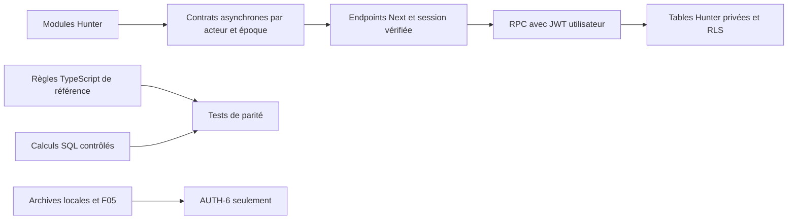

# AUTH-4A — Contrat de persistance cloud Hunter

Date : 13 octobre 2026. Révision de conception 1, fondée sur le code au commit `18425f5`, branche `feature/lifequest-improvements`. **Document à valider ; aucun schéma métier, RPC RPG, reader ou raccordement frontend n'est implémenté ici. AUTH-4B reste interdit avant validation distincte.**

Références lues : AGENTS.md, AUTH_CLOUD_IMPLEMENTATION_PLAN.md, AUTH_2_FOUNDATIONS_REPORT.md, AUTH_3_IMPLEMENTATION_REPORT.md, F05_FINAL_VALIDATION.md, tools/auth2/README.md. Sources principales : `frontend/src/types/index.ts`, `questSystem.ts`, `questActions.ts`, `hunterCore.ts`, `activityRewards.ts`, `hunterMissions.ts`, `hunterLab.ts`, `profile.ts`, `achievements.ts`, `validation.ts`, les hooks de stockage, FocusDungeon, HunterTransition, LevelCinematicGate et les pages Arcs/Lab. Les chemins abrégés de bibliothèques désignent `frontend/src/lib`.

## 1. Décision et limites

Conserver l'architecture RPC retenue : Next vérifie l'utilisateur et la session, appelle PostgREST avec le JWT utilisateur et la clé publishable ; PostgreSQL vérifie aussi l'acteur, la session, les permissions et les invariants. Aucune connexion PostgreSQL dans le runtime Next et aucune service_role pour le gameplay. Les règles TypeScript restent la référence fonctionnelle ; leur portage SQL doit prouver la parité avant raccordement.

AUTH-4 vise une progression réellement persistée, pas l'import historique. AUTH-5 fournira les workflows de création du profil/onboarding/présentation ; AUTH-6 fournira récupération et transfert explicites. Un nouvel utilisateur provisionné à zéro est seulement une enveloppe non configurée. Il reste masqué, sans dashboard, démonstration, cinématique ou création de profil implicite.

Un compte déjà configuré doit avoir une preuve serveur de configuration, un profil valide et un snapshot complet. Une fixture administrative fictive pourra représenter ce cas dans les tests ; aucune API de test permettant de rendre un compte réel ready ne sera publiée.



## 2. Inventaire de la persistance existante

| Source persistée | Modèle réel et champs | Nature / destination proposée |
| --- | --- | --- |
| `lifequest-profile-v1` | HunterProfile : name, age, gender, avatar, goals[], onboardingCompleted=true, createdAt | Profil autoritatif ; `hunter_profiles`. Brouillon/complétion future séparés. Aucun e-mail/mot de passe dupliqué comme identité. |
| `lifequest-quest-system-v1` | QuestSystemState v1 : totalXP, quests[], arcs[], completions[], achievements? | Solde transactionnel + collections, jamais JSON client remplaçant tout le compte. |
| quests[] | SystemQuest : id, title, description, xp, difficulty, attribute, frequency, createdAt ; arcId?, targetDate?, archived?, availableAfter?, revision? | `quests`. xp est la base enregistrée, pas l'XP final. Les anciennes bases personnalisées sont conservées. |
| arcs[] | StoryArc : id, title, description, targetDate, createdAt | `story_arcs`. Suppression détache les quêtes sans modifier leurs crédits. |
| completions[] | Completion : id, questId, period, completedAt, xpAwarded, attribute ; questTitle?, arcId? (null admis) | Ledger `xp_events` ; identité, période, montant, attribut et snapshots immuables. |
| achievements? | AchievementUnlock : id, unlockedAt ; six IDs fermés | `achievement_unlocks`. Critères dérivés ; déverrouillage monotone, aucune récompense XP. |
| `lifequest-core-v011` | CoreSettings v1 : baselineXP, baselineLevel, stability, lastPenaltyDay, penaltyDays[], initializedAt | `hunter_settings` historique. Stabilité effective=100 ; baseline ne s'ajoute jamais au total. Ordre et doublons éventuels des penaltyDays conservés. |
| `lifequest-hunter-operations-v1` | ExtraState v1 : bosses[], events[] | Tables Operations, avec ordre des collections conservé. |
| bosses[] | BossMission : id, title, objective, target, current, xp, createdAt ; completedAt?, rewardStatus?, subObjectives? | `boss_missions` ; mode déduit de la présence des sous-objectifs, non d'un champ existant. |
| subObjectives[] | id, title, weight, completed | `boss_subobjectives`, identifiant unique **dans un Boss**. Ordre conservé. |
| events[] | HunterEvent : id, kind boss/rank/evolution, title, at, detail? | `system_events`. Événements de présentation distincts des reçus XP. |
| `lifequest-hunter-lab-v1` | LabData v1 : ideas[], nodes[], resources[], journal[], sessions[], challenges[] | Hunter Lab est un agrégat de six collections et de statistiques dérivées ; aucune septième collection « Lab » à inventer. |
| ideas[] | id, title, content, tag, createdAt, archived | `ideas`. Ajout en tête, archive/restauration et suppression sans XP. |
| nodes[] | id, title, parentId=null ou id, x, y | `mind_nodes`. Parent du même compte, arbre sans cycle. Coordonnées persistées ; la vue actuelle recalcule sa grille et ne propose pas de drag métier. |
| resources[] | id, title, notes, url, topic, mastered, createdAt | `resources`. URL vide autorisée ; sinon HTTP(S), sans credentials. Aucun XP pour mastered. |
| journal[] | id, date, wins, challenges, gratitude, tomorrow | `journal_entries`. Un seul journal par jour local, modification conserve son ID ; suppression sans XP. |
| sessions[] | Session : id, date (timestamp), minutes, label, rewardStatus? pending/credited | `focus_sessions`. Historique sans statut conservé ; pas de reçu fictif déduit des minutes. |
| challenges[] | id, prompt, response, date (timestamp), completed | `creativity_challenges`. Plusieurs créations par jour possibles ; le libellé DAILY de l'UI n'est pas une contrainte métier. Aucun XP actuel. |
| `lifequest-hunter-timer-v1` | mode focus/short/long, secondsLeft, runningUntil=null ou epoch ms, label, sessionId? | `focus_runs` pour les nouveaux minuteurs contrôlés serveur ; brut historique réservé à AUTH-6, pas de crédit spontané. |
| `lifequest-hunter-transition-v1` | Nombre entier 1..100 | Historique de présentation, pas une preuve de niveau ; futur `presentation_state` en AUTH-5. |
| `lifequest-cinematic-seen-v1:<préfixe>:5/10/20` | Chaîne `1`, préfixe createdAt/nom/local-player | Consommation historique, pas visionnage intégral ; futur cinematic_progress AUTH-5/6. |
| `lifequest-v2-demo` | Ancien GameState ; seul totalXP est exploité par legacyXP | Archive/miroir historique. Ne pas recopier ses quêtes de démonstration ni additionner son solde. |
| `lifequest-import-journal-v1` | Journal F05 before/after, prepared/committed, clés et valeurs brutes | Preuve locale de récupération ; jamais donnée Hunter cloud ni entrée automatique de provisioning. |

Les caches de hooks, Web Locks, notifications, Set sessionSeen, brouillons React, onglet sélectionné, notices et index de prompt sont des états de navigateur. Ils ne prouvent ni identité ni progression. Les brouillons perdus ne sont pas reconstructibles. Aucun autre stockage métier n'est identifié par l'inventaire source.

Sont dérivés : niveau et progression intra-niveau, rang, attributs (somme des reçus), avatar/évolution, séries, métriques achievements, avancement des Arcs et des Boss pondérés, analytics Focus/Lab. Ne pas les accepter comme valeurs d'écriture clientes.

## 3. Incompatibilités à résoudre explicitement

| Écart avec une transposition SQL naïve | Contrat retenu ou blocage |
| --- | --- |
| IDs historiques non UUID, parfois avec `:` | IDs métier text inchangés. Seul user_id est Auth UUID. Ne pas découper un ID d'activité par le dernier `:` ; retirer le préfixe connu en conservant tout le suffixe. |
| Sous-objectifs : même ID admissible dans deux Boss | PK `(user_id,boss_id,id)` et FK composite vers le Boss ; corrige la PK trop générale envisagée dans AUTH-1. |
| IDs réutilisables entre collections Lab | Chaque collection a sa propre PK `(user_id,id)`. Aucun registre imposant une unicité métier globale. |
| absent / null / false / zéro | DTO canonique documenté et métadonnées historiques de présence. Counter Boss omet subObjectives ; Session ancienne omet rewardStatus ; profil absent reste null. Ne pas déclarer un historique payé/vu par défaut. |
| Ordre des tableaux | `sort_position bigint` par acteur/collection, allocation sous verrou. Pas de tri arbitraire par date/UUID. Journal trié par date décroissante comme l'UI ; autres ordres historiques conservés. |
| Reçu orphelin | validState refuse un reçu de quête normale sans quête, mais autorise les références préfixées `lifequest:activity:` sans activité présente. Pas de FK destructrice sur source/arc snapshot ; cohérence appliquée selon la provenance. |
| Préfixe d'activité inconnu | Le validateur accepte aussi d'anciennes références préfixées autres que focus/boss. `source_kind=legacy_activity` privé à la migration, source_ref conservée opaque ; aucune commande d'attribution générique publiée. |
| xp et minutes historiquement fractionnaires | numeric sans scale imposée ; pas integer/numeric(...,0), pas d'arrondi d'import. Durées nouvelles et rewards nouveaux suivent leurs règles fermées. |
| JS number versus PostgreSQL numeric | Stockage décimal fidèle, calcul binaire/arrondi de référence à prouver (§5). La parité exacte des futurs soldes fractionnaires reste une décision bloquante, pas une garantie documentaire. |
| Révisions number non sûres admises par Number.isInteger | Révisions cloud bigint transportées en chaînes. Adaptateur legacy number seulement après contrôle de plage sûre. Révision historique hors plage bigint/sûre : diagnostic et blocage, sans troncature/reset. |
| URL facultative | `url=''` admis ; HTTP(S) sans username/password sinon. Un CHECK seulement « commence par http » est insuffisant. |
| Texte JS permissif versus PostgreSQL UTF-8 | NUL, surrogate isolé, chaînes/IDs énormes peuvent être admis localement. Diagnostics avant staging/SQL ; aucun remplacement silencieux. Limites de transport séparées des contraintes historiques. |
| Dates et format d'origine | timestamptz/date canoniques + texte d'origine validé dans les métadonnées historiques. Millisecondes pour timestamps nouveaux ; pas de perte d'offset/précision dans l'export historique. Année JS 0000 et formats non représentables : blocage explicite avant import. |
| Champs inconnus admis par les validateurs | Conserver comme extras historiques privés/non autoritatifs pour export ; ne pas les propager comme permissions ou montants clients. Payloads des nouvelles commandes fermés. |
| deleteArc ne révise pas actuellement les quêtes détachées | La version cloud proposée révisera les lignes réellement détachées pour éviter l'écrasement d'un brouillon. Ajout de contrôle concurrent à valider ; aucune modification du code local ici. |

## 4. Modèle PostgreSQL proposé

Tables métier dans un schéma privé `lifequest`, absent des schémas exposés à la Data API. Façade RPC publique uniquement. Schémas/objets `auth2_proof` et auth2_* restent des preuves séparées ; aucune commande réelle ne les appelle. Leur retrait de l'exposition avant publication ne supprime pas leurs données ni les quatre migrations historiques.

Commun aux collections : user_id, ID métier text, revision bigint>=0 et sort_position ; created_at/updated_at lorsque pertinents. Métadonnées de compatibilité séparées des champs mutables, réservées à la migration et à l'export. Index par user_id, FK, période et ordre ; unicités et relations incluent l'acteur.

| Table | Colonnes spécifiques et contraintes |
| --- | --- |
| hunters | PK/FK user_id→auth.users ; total_xp, opening_xp, legacy_roundoff_delta numeric ; timezone IANA nullable tant que non confirmée, timezone_confirmed_at, rules_version, revision, created_at. Total>=0, nombres finis ; delta uniquement historique. |
| hunter_setup | PK user_id ; origin_choice null/new/legacy, chosen_at, migration_id nullable, configuration_status pending/ready/migration_pending/recovery_required, revision. Autorité serveur ; aucune commande générale permettant de passer ready. |
| hunter_modules | PK(user_id,module_code), module_code fermé system/operations/lab/settings, schema_version, initialized, revision, collection_counts et métadonnées de présence historique. En-têtes initialisés explicitement au provisioning ; compteurs mis à jour dans les mêmes transactions que les collections. Une absence d'en-tête n'est jamais assimilée à un module vide. |
| hunter_profiles | PK user_id ; name non vide <=40, age entier 13..120, gender enum actuel, avatar male/female, goals text[] ordonné, onboarding_completed, original_created_at. Profil final compatible validProfile ; brouillons AUTH-5 séparés. |
| hunter_settings | PK user_id ; version=1, baseline_xp, baseline_level 1..100, historical_stability 0..100, last_penalty_day nullable avec présence conservée, penalty_days date[] ordonné, initialized_at. Stabilité effective DTO=100 ; historique non effacé. |
| story_arcs | title, description, target_date date, created_at ; titres non uniques. |
| quests | title, description, frequency enum daily/weekly/monthly/once, difficulty EASY/NORMAL/HARD, attribute enum actuel, base_xp numeric 0..300, arc_id nullable FK `(user_id,arc_id)`, target_date/available_after date nullable, archived boolean. ID ne commence pas par le préfixe d'activité. |
| xp_events | id, legacy_quest_id/source_ref, source_kind quest/focus/boss/legacy_activity, source_id, period_key text, awarded_xp numeric>=0 fini, attribute, occurred_at, title_snapshot et arc_id_snapshot nullable, rules_version/provenance. UNIQUE(user_id,source_ref,period_key). Activités : once seulement. Pas d'UPDATE/DELETE dans le runtime. |
| achievement_unlocks | PK(user_id,achievement_id) ; unlocked_at ; catalogue des six IDs. INSERT idempotent seulement. |
| boss_missions | title, objective, mode counter/weighted, target/current, base_xp 0..300, created_at, completed_at nullable, reward_status nullable/pending/credited/resolved_without_xp. Counter : target entier 1..1000, current entier 0..target. |
| boss_subobjectives | PK(user_id,boss_id,id), title, weight entier 1..1000, completed, sort_position ; 1..20 lignes en weighted, somme<=1000 et snapshots target/current cohérents. |
| system_events | kind boss/rank/evolution, title, occurred_at, detail nullable ; IDs uniques par acteur. Les futurs IDs milestone-5…100 restent distincts des reçus. |
| focus_runs | id, mode focus/short/long, status idle/running/paused/completed/cancelled, remaining_seconds, running_since/deadline_at nullable, accumulated_active_ms, label, revision ; durée initiale serveur 1500/300/900 s. |
| focus_sessions | id lié au run pour les nouvelles sessions seulement, occurred_at, minutes numeric 0..1440, label, reward_status nullable/pending/credited. Pas de FK obligatoire vers un run pour les historiques. |
| ideas | title, content, tag, archived, created_at. |
| mind_nodes | title, parent_id nullable FK `(user_id,parent_id)`, x/y double precision finis, revision ; cycles contrôlés sous verrou. |
| resources | title, notes, url, topic, mastered, created_at ; URL vide ou HTTP(S) sans credentials. |
| journal_entries | id, local_date, wins/challenges/gratitude/tomorrow text ; UNIQUE(user_id,local_date). |
| creativity_challenges | prompt, response, occurred_at, completed ; pas d'unicité quotidienne, pas de crédit XP. |
| command_receipts | PK(user_id,request_id UUID), command_kind, canonical_payload_hash, minimal_result jsonb, committed_revision, committed_at. Payload différent sous même ID refusé ; aucune suppression runtime. |

Les tables onboarding_progress, cinematic_progress, presentation_state et migration_batches/sources/snapshots suivent AUTH-1 mais leurs workflows appartiennent à AUTH-5/6. AUTH-4B réserve les relations nécessaires dans setup, sans écrire des checkpoints consommés ni une migration fictive.

Contrôles numériques : total/opening non négatifs et finis ; delta signé fini, modifiable uniquement par la migration future. Un rapprochement ledger implique des agrégats, pas un CHECK SQL contenant une sous-requête : prévoir sa validation sous verrou dans les commandes et le reader, puis évaluer un constraint trigger différé de cohérence en AUTH-4B. Ne pas présenter une contrainte de colonne comme une garantie inter-tables.

La suppression de quête n'est pas une commande actuelle : archive/remise en service uniquement. La suppression d'Arc détache les liens actifs dans la transaction ; les snapshots de reçus ne changent pas. La suppression de nœud rattache ses enfants à la racine. Pas de cascade effaçant XP/reçus/événements historiques à la disparition d'une activité ou d'un Arc. L'effacement complet d'un compte est une procédure distincte, hors AUTH-4A.

## 5. Référence des règles et parité numérique

| Règle source | Contrat à porter, sans modification |
| --- | --- |
| Niveau (`getHunterProgress`) | Coût du niveau n : `200+25*(n-1)` ; soustractions successives, niveau initial 1, plafond 100. Au plafond : current=0, required=0, percent=100. Sinon percent=min(99,floor(current/required*100)). Baseline ignorée pour le niveau. |
| Rang (`rankForLevel`) | E<10, D≥10, C≥20, B≥30, A≥40, S≥50. |
| Nouvelle quête (`draftQuest`) | Base EASY=30, NORMAL=50, HARD=80. Le champ xp du brouillon n'est pas une autorité. Même difficulté lors d'une édition : ancienne base conservée ; changement de difficulté : base du catalogue. |
| Série courante (`streakDays`) | Jours uniques des seules quêtes ; commence aujourd'hui si présent, sinon hier ; jours consécutifs, limite 10000. Bonus calculé **avant** insertion de la nouvelle complétion. Boss/Focus ne prolongent pas la série. |
| Multiplicateur | 1 avant 7 jours, 1.1 à partir de 7, 1.25 à partir de 30 ; stabilité toujours multiplicateur 1, pas de pénalité de repos. |
| Crédit quête | `Math.round(base enregistrée * multiplicateur)` ; reçu et solde/achievements dans la même transaction. Attribut et titre/Arc du reçu capturés lors de l'action. |
| Boss neuf pondéré | 1..20 sous-objectifs, total des poids<=1000 ; base=min(300,max(25,total*10)), attribut discipline. Dernier objectif, événement boss et crédit atomiques. |
| Focus neuf | Mode focus terminé, ID stable, 25 minutes ; base20, attribut focus, bonus de série des quêtes. Pauses/résumés ne créent pas un nouveau reçu. Repos court/long sans crédit. |
| Attributs | Somme des montants des reçus par attribut, aucun partage inventé du solde d'ouverture. |
| Achievements | first-clear=1 quête, quest-veteran=100, discipline-master=30 quêtes discipline, rank-d-hunter=niveau10, rank-s-hunter=niveau50, seven-day-streak=meilleure série historique7. Focus/Boss exclus des compteurs de quêtes et de série ; aucun XP ajouté. |

Le stockage numeric protège les fractions historiques mais ne prouve pas la parité de calcul avec JS number. PostgreSQL distingue calcul décimal et calcul flottant, notamment pour les arrondis ; voir [types numériques PostgreSQL 17](https://www.postgresql.org/docs/17/datatype-numeric.html).

Deux sondes Node de conception donnent : `0.45454545454545453*1.1 === 0.5`, donc Math.round=1 ; un calcul décimal exact du même produit est inférieur à 0.5. Et Math.round(0.49999999999999994)=0, tandis que floor(x+0.5)=1. **Ni ROUND(numeric) ni le raccourci flottant floor(x+0.5) ne sont une traduction universelle de la référence.**

Candidat AUTH-4C : multiplier en double precision comme number, puis arrondir les valeurs non négatives en comparant la partie fractionnaire à 0.5, sans l'addition +0.5. Ce candidat doit être testé réellement en SQL, pas accepté sur description. Toutes les nouvelles bases de catalogue et les bases historiques admissibles font partie des fixtures.

Solde : `total_xp = opening_xp + somme des reçus + legacy_roundoff_delta`. Opening initial=0 ; delta initial=0, réservé à un reliquat historique validé et jamais à masquer une incohérence. Aucun cumul avec baselineXP/miroir legacy. Les additions décimales et les additions JS successives peuvent aussi différer d'une ULP : **valider une politique explicite avant AUTH-4C pour les soldes historiques fractionnaires**, ou maintenir ces fixtures bloquées. Ne pas injecter automatiquement un nouveau delta d'arrondi après chaque commande.

La parité des niveaux et métriques est mesurée sur le même total projeté en number, avec contrôle des limites finies et des frontières. Les valeurs exactes restent disponibles dans l'enveloppe décimale ; les DTO number doivent passer les validateurs et le contrôle d'agrégat. Une égalité décimale et une équivalence number ne doivent pas être confondues.

Autre sonde source : validState accepte actuellement totalXP=1e308 avec deux reçus d'activité à 1e308 chacun, car la somme et sa tolérance deviennent Infinity. Le contrat cloud exige aussi des agrégats finis et un rapprochement réel ; ce cas est **diagnostiqué/bloqué**, sans modifier le validateur local ni la sauvegarde. Ce constat interdit d'utiliser validState seul comme garantie SQL ou d'import.

## 6. Jours, périodes et disponibilité

Une commande capture un instant serveur après acquisition du verrou métier ; toutes ses décisions utilisent cet instant et le fuseau IANA confirmé du Hunter. Pas de jour, period_key ou heure de fin fournis comme preuve par le navigateur. Un fuseau absent bloque les mutations RPG, sans choisir silencieusement celui du serveur. AUTH-5 devra confirmer ce fuseau ; les fixtures locales le fixent explicitement.

Périodes : once=`once` ; daily=`YYYY-MM-DD` ; monthly=`YYYY-MM` ; weekly=`week:YYYY-MM-DD`, date du lundi. Jours calendaires, pas décalages de 24 h : DST, Casablanca et années bissextiles dans les tests. Un historique garde ses périodes existantes, indépendamment de la timezone choisie ensuite. L'ancien fuseau n'est pas stocké : impossible de prétendre le reconstruire. La politique des jours historiques pour les futurs bonus est à valider avant AUTH-6.

Due : archived ou availableAfter>jour ⇒ refus ; once dépend de targetDate si présent ; récurrent dépend de la date locale de createdAt. Ne pas ajouter à once un contrôle de createdAt absent de la règle actuelle. Une once déjà terminée reste terminée après restauration et ne peut pas devenir récurrente.

Édition de fréquence avec reçu existant : availableAfter=max(prochaine période ancienne, prochaine période nouvelle, ancienne limite). daily et once : lendemain ; weekly : prochain lundi ; monthly : premier du mois suivant. Sans reçu, conserver la limite éventuelle sans nouveau cooldown. Pas de diminution de limite ni d'effacement de reçu par édition/restauration.

Politique proposée : pas de changement de fuseau pendant AUTH-4 ; future commande dédiée avec analyse des crédits par période, jamais une préférence cliente libre. Arcs nouveaux : date entre le jour confirmé et sa borne « +2 ans » calculée comme le code JS, y compris report du 29 février ; ne pas assimiler sans test à un intervalle SQL différent. Journaux nouveaux : date locale choisie ≤jour courant ; dates historiques valides conservées.

## 7. DTO et contrats asynchrones

Schéma de conception, pas fichier TypeScript installé :

```ts
type Revision = string; // entier décimal non négatif, contrôlé avant usage
type Decimal = string;  // décimal fini ; jamais NaN/Infinity
type RequestContext = {
  expectedActor: string; requestId: string; expectedRevision?: Revision;
};
type HunterData = {
  profile: HunterProfile; system: QuestSystemState; extra: ExtraState;
  lab: LabData; settings: CoreSettings; timer: CloudFocusRun | null;
};
type ReadySnapshot = {
  schemaVersion: 1; actor: string; revision: Revision; rulesVersion: string;
  state: 'ready'; serverTime: string; timezone: string;
  data: HunterData; entityRevisions: EntityRevisionMap;
  exactXP: { total: Decimal; opening: Decimal; roundoff: Decimal };
  derived: HunterDerived; presentation: { state: 'auth5_pending' };
};
type BootstrapResult = ReadySnapshot | {
  schemaVersion: 1; actor: string; revision: Revision;
  state: 'setup_pending' | 'migration_pending' | 'recovery_required';
  reason: string; // code fermé ; pas de snapshot RPG partiel affichable
};
type CommandResult = {
  actor: string; requestId: string; committedRevision: Revision;
  outcome: 'applied' | 'noop' | 'already_credited'; replayed: boolean;
  result: CommandSpecificResult; // IDs/révisions/récompense calculée
};
type ClientLoadState =
  | { state: 'loading'; actor: string; epoch: number }
  | { state: 'ready'; actor: string; epoch: number; snapshot: ReadySnapshot }
  | { state: 'error'; actor: string; epoch: number; code: string }
  | { state: 'session_expired'; epoch: number };
```

HunterProfile, QuestSystemState, ExtraState, LabData et CoreSettings désignent les types source inventoriés. CloudFocusRun porte les colonnes du timer (§4) avec révision chaîne ; EntityRevisionMap associe collection/ID (et boss_id pour sous-objectif) à une révision ; HunterDerived porte progress, rank, attributeXP et statistiques déjà existantes. CommandSpecificResult est fermé par commande (§8). Ces aliases seront écrits et validés en AUTH-4C/D ; le snippet n'est pas une preuve de compilation.

Le DTO compatible conserve version=1 et les noms des modèles existants. Les nouveaux IDs peuvent être UUID textuels ; dates nouvelles ISO UTC à la milliseconde. Une ancienne revision number n'est projetée que si sûre ; les contrôles concurrents cloud utilisent les chaînes de l'enveloppe. Une donnée absente légitime n'est pas fabriquée : profile nul pour setup pending, timer nul si aucun run, collections vides seulement si le snapshot complet valide les contient réellement vides.

Erreurs fermées : AUTH_REQUIRED/SESSION_EXPIRED, ACTOR_MISMATCH, SETUP_PENDING, ACCOUNT_MISSING, SNAPSHOT_INCONSISTENT, MODULE_INVALID, REVISION_CONFLICT, REQUEST_ID_CONFLICT, NOT_FOUND, NOT_DUE, VALIDATION_FAILED, PAYLOAD_TOO_LARGE, SNAPSHOT_TOO_LARGE, SERVICE_UNAVAILABLE. Aucune donnée brute ou e-mail dans les messages. 401/403 verrouillent le métier ; 409 préserve le brouillon de la même session ; 503 n'initialise rien. Issue réseau indéterminée : état de commande `outcome_unknown`, interrogation du reçu avant retry avec le même ID.

Façade prévue : GET `/api/hunter/bootstrap`, GET `/api/hunter/receipts/:requestId`, POST `/api/hunter/commands/:kind`, export serveur explicite. Endpoints et chaque RPC vérifient la session ; POST Origin/CSRF et parsing borné. Le parseur Auth limité à 4 KiB n'est pas réutilisé aveuglément pour Lab. Proposition de plafond commande 1 MiB à mesurer/valider, jamais de troncature ; snapshot trop volumineux = erreur explicite, pas un tableau incomplet considéré ready. Le plan de pagination cohérente par revision sera requis si le chargement complet dépasse les limites mesurées en AUTH-4D.

Cache mémoire exclusivement `(actor,sessionEpoch,schemaVersion)`, aucun cache persistant/offline. Contrat de reader Promise, pas readLab/loadState synchrones de substitution. À changement d'identité : masque, abort, purge des caches/notices/brouillons/timers/sessionSeen/dialogues et changement d'époque. UUID et époque sont vérifiés avant **et après** décodage de toute réponse. BroadcastChannel ne transporte que l'invalidation ; focus/visibilité et toute mutation revalident côté serveur. Aucune intention A n'est rejouée sous B, même si leurs IDs textuels sont identiques.

## 8. Catalogue des commandes prévues

Toutes portent expectedActor/requestId. Les mises à jour et suppressions exigent une révision de cible ; créations : ID attribué serveur et reçu stable. Pas de callback arbitraire changeQuests/mutateLab/mutateExtra, montant final, level/rank/attribute totals, rewardStatus, completedAt, receipt ou snapshot intégral dans un payload client.

| Commande | Intention et résultat spécifique | Effet XP / invariants |
| --- | --- | --- |
| quest.create | title/description/frequency/difficulty/attribute/arcId?/targetDate? → ID, revision | Base catalogue serveur ; deux intentions de même titre permises. |
| quest.update | ID, expectedRevision, mêmes champs → revision | Base personnalisée conservée si difficulté identique ; cooldown et once terminée conservés. |
| quest.archive / quest.restore | ID, état désiré, revision → revision/état | Même ID, historique intact. Déjà dans l'état : noop sans hausse de revision. |
| quest.complete | ID → title/xp/levelBefore/levelAfter/receiptId ou already_credited | Sous verrou, due/période réelles, calcul fiable et unique crédit par période. |
| arc.create / arc.delete | titre/description/date ou ID/revision → ID/détachements | Suppression conserve quêtes et snapshots de reçus, révisions des lignes modifiées. Pas de commande arc.update inventée. |
| boss.create | titre et titres/poids des objectifs → Boss/IDs/revisions | Weighted neuf uniquement ; pas de base XP ni mode legacy fournis. |
| boss.progress | BossID, subID?/revision → avancement et récompense éventuelle | Counter historique +1 ou objectif weighted validé une seule fois ; dernier objectif atomique. |
| boss.claim | BossID/revision → credited/already_credited/resolved_without_xp | Reprise historique F03/F04, même reçu, aucun bonus recalculé s'il existe. |
| focus.start / pause / resume / cancel / set_mode | runID/revision, mode/label selon action → run/temps serveur | ID stable ; modes serveur ; reset annule sans crédit et départ suivant avec nouvel ID. |
| focus.finish / claim | run/sessionID/revision → session/reçu/récompense | Nouveau run expiré et 25 min actives vérifiées serveur ; imported expired timer sans crédit automatique. |
| idea.create / set_archived / delete | champs actuels, ID/revision pour transition → ID/état | Aucun XP. État désiré explicite plutôt qu'un toggle rejouable. |
| node.create / delete | titre, parent candidat ou ID/revision → ID/liens | Parent disparu sous verrou ⇒ racine, comme F02 actuel ; suppression rattache enfants à racine. Aucune recherche dans B. Cycle interdit ; pas de drag/reparent UI inventé. |
| resource.create / set_mastered / delete | champs actuels, état désiré ou ID/revision → ID/état | URL facultative sûre ; aucun XP. |
| journal.save / delete | date/contenus, revision (ou attente d'absence) → ID/revision | Un seul journal par acteur/date ; upsert garde l'ID, conflit refuse l'écrasement. |
| creativity.submit | prompt du catalogue existant, réponse → ID | Création completed serveur, sans unicité journalière ni XP. |
| achievement.sync | Aucun montant/ID à déverrouiller → nouveaux IDs | Backfill fiable des seuls critères existants ; monotone et sans XP. |

Profil/choix d'origine/checkpoints : tables et contrats préparés, commandes de parcours réservées AUTH-5/6. Settings : lecture de l'historique, aucune modification cliente libre de baseline, stability ou règles. System Events : événements Boss créés dans leur transaction ; présentation rank/evolution et milestones gérées en AUTH-5, pas de commande client append_event. Pas de suppression de session/reçu XP, modification de récompense ou import complet dans le catalogue courant.

F03 : un counter historique terminé, xp=0, sans reçu positif ⇒ resolved_without_xp, sans reçu ni XP ni événement/achievement supplémentaire. Un reçu positif préexistant ⇒ credited conservé, même si l'ancien Boss porte xp=0. Un credited sans preuve positive, un resolved_without_xp avec preuve positive ou un reçu zéro bloquant une récompense positive ⇒ diagnostic, pas réparation silencieuse.

F04 : Session avec rewardStatus explicite doit être à 25 min ; credited exige son reçu positif exact. Sessions historiques sans statut et références d'activités orphelines admissibles restent conservées. pending avec reçu positif retrouve le reçu, ne refait pas le calcul. Les nouvelles opérations cloud quittent pending, créditent et finalisent en une transaction ; elles ne reproduisent pas les écritures multi-clés locales interrompables.

Une ancienne Session pending sans reçu ni run serveur ne prouve pas une durée authentifiée. Son admission historique par F04 et sa conservation ne suffisent pas à l'autoriser comme nouveau Focus cloud. La politique de reprise explicite de ce cas sera validée en AUTH-6 ; en AUTH-4, diagnostic et absence de crédit automatique. Aucun statut ancien ne sera effacé pour résoudre cette différence de confiance.

## 9. Transaction, reçus et sessions concurrentes

Mutation en un POST RPC VOLATILE, une transaction : vérifier claims/session/utilisateur confirmé → garde de session → verrou hunters de l'acteur → vérifier setup/timezone/migration → rechercher request_id → contrôler payload/revision → lire cibles → calcul → écritures métier/ledger/achievements/événement → revision globale → receipt → résultat. Exception non absorbée = rollback de l'ensemble. [Transactions PostgREST](https://docs.postgrest.org/en/stable/references/transactions.html).

Tous les chemins prennent les verrous dans le même ordre : session courante si verrou réalisable (§10), Hunter, entités triées par collection/ID, reçus. Premier choix : un verrou de Hunter par acteur pour sérialiser les mutations inter-modules et les bons bonus. Les contraintes uniques défendent aussi une concurrence inattendue. Pas de verrou partagé entre A et B.

Hash SHA-256 calculé côté SQL sur un payload canonique versionné contenant command_kind, cible, champs d'intention et préconditions. Exclure requestId, cookies, époque de présentation et timestamps inventés ; conserver expectedRevision comme partie de l'intention. Le canonicaliseur est spécifié/testé des deux côtés ; le hash fourni par le client n'est pas cru. Même ID/différent hash ⇒ conflit, même hash ⇒ résultat enregistré **avant contrôle de la révision devenue ancienne**. Un retry valide doit revalider l'acteur/session mais ne recalculer ni temps, ni bonus, ni crédits.

Deux request_id pour la même complétion : unicité du reçu de progression évite le second crédit, et le second résultat est already_credited. request_id différent pour un autre titre identique : création légitime. Les noops retournent un résultat durable sans augmenter les révisions métier. Chaque vraie transition augmente les révisions des entités changées et une seule revision globale. Une erreur ne publie pas un receipt de succès.

Archive/restauration : si l'état demandé est déjà celui de la ligne, noop sans réécriture, même si la révision observée est ancienne ; le conflit de révision protège les transitions qui changeraient réellement la ligne. Les éditions de brouillon restent strictement contrôlées. Un reader retournant « reçu absent » pendant une commande encore en vol ne prouve pas un échec : rester outcome_unknown et reprendre uniquement le même ID/payload sous le verrou transactionnel.

Résultat minimal immutable : IDs, montant accordé, niveaux au moment du crédit, révision committed et résultat de transition. Pas de vieux snapshot entier dans un receipt ; une réponse rejouée ancienne provoque une relecture et ne remplace pas une revision plus récente en mémoire. Reçus non purgés pendant AUTH-4 ; éventuelle rétention future doit préserver l'idempotence, jamais recréer un solde à partir d'une réponse perdue.

Après reload ou réauthentification ayant détruit la mémoire privée, ne pas fabriquer un nouvel ID pour une création dont l'issue reste inconnue. Prévoir en AUTH-4D un reader paginé des receipts récents du seul acteur, avec leurs IDs/résultats minimaux, et une relecture des entités pour résolution explicite. Pas de replay automatique ni de file locale de payloads. Un même titre ne permet jamais de conclure que deux intentions sont identiques ; si l'ID initial n'est pas retrouvable sans ambiguïté, demander une nouvelle intention explicite après présentation de l'état cloud.

## 10. RLS, rôles et révocation

Rôles proposés distincts : lifequest_schema_owner NOLOGIN propriétaire des tables ; lifequest_command_owner NOLOGIN mutateur non propriétaire sans BYPASSRLS/SUPERUSER ; lifequest_read_owner NOLOGIN SELECT seulement, non propriétaire ; lifequest_provision_owner NOLOGIN INSERT limité au provisioning initial. Aucun rôle de gameplay ne dispose du login de migration ni d'une appartenance privilégiée.

Toutes les tables : ENABLE RLS + FORCE RLS dans leur migration de création et grants révoqués avant commit. authenticated/anon n'ont aucun DML, aucun accès aux tables privées ; seuls les RPC publics allowlistés reçoivent EXECUTE authenticated. Command/read owners sont soumis aux politiques par user_id et session. Les helpers privés ne sont pas exposés ; propriétés/search_path='' et ACL vérifiées effectivement après transfert de propriété, comme l'a exigé la correction AUTH-2. [Fonctions Supabase](https://supabase.com/docs/guides/database/functions), [RLS PostgreSQL](https://www.postgresql.org/docs/17/ddl-rowsecurity.html).

Le helper AUTH-2 actuel ne prouve pas à lui seul l'état confirmed actuel, une politique d'inactivité distante, ni une révocation instantanée en pleine transaction. Prévoir un helper Auth étroit vérifiant l'utilisateur réel, le session_id et l'expiration au temps réel ; aucun UID de substitution en argument et aucune ligne Auth retournée. Les helpers Auth privilégiés restent distincts des commandes XP limitées.

Décision de concurrence à tester en AUTH-4B : un verrou FOR KEY SHARE sur la session courante, acquis par ce helper étroit jusqu'au commit. Si logout a gagné, refuser/rollback ; si une commande valide a verrouillé avant logout, elle termine avant la révocation, laquelle attend. Expiration recontrôlée après attentes et avant fin. **Ne pas promettre qu'un logout annule rétroactivement toute commande déjà autorisée.** Le masquage client/époque empêche son ancienne réponse de s'afficher sous B.

Permissions et compatibilité Auth gérée de ce verrou doivent être démontrées. S'il échoue ou perturbe Auth, arrêter et demander validation d'une sémantique différente ; ne pas ajouter un droit d'écriture libre à auth.sessions. Tester aussi délais/deadlocks et limites courtes. Les tests de révocation ne doivent pas vérifier seulement la disparition d'un cookie React.

Provisioning : trigger Auth minimal avec NEW.id, jamais user_metadata comme permission, rôle dédié et politique INSERT limitée à zéro/pending, sans UPDATE/DELETE. hunters/setup/settings créés atomiquement une seule fois. Le rôle de provisioning n'a pas besoin de claims utilisateur au moment du signup ; sa politique de confiance est distincte et sa fonction trigger n'est pas callable comme RPC. Erreur du trigger visible ; login/bootstrap ne provisionnent rien. Réparation d'un compte manquant explicitement autorisée côté serveur, sans remise à zéro d'un compte existant.

## 11. Bootstrap et raccordement ultérieur

Un seul RPC read-only retourne une agrégation sous **un même snapshot SQL**, avec toutes les collections, leur ordre, profil/setup/settings et la revision. Une seule transaction contenant plusieurs SELECT READ COMMITTED distincts n'est pas une preuve suffisante de cohérence ; préférer une requête agrégée STABLE, ou une isolation repeatable read réellement configurée/testée. Pas d'appel HTTP séparé par module. L'API valide ensuite les DTO, les agrégats finis, le rapprochement ledger et les invariants F03/F04 avant ready.

La qualification STABLE engage aussi la stratégie de snapshot des requêtes internes ; voir [volatilité des fonctions PostgreSQL 17](https://www.postgresql.org/docs/17/xfunc-volatility.html). Le verrou de session proposé doit être vérifié contre les conflits de row locks et le comportement Auth réel, selon [verrous PostgreSQL 17](https://www.postgresql.org/docs/17/explicit-locking.html).

Compte manquant ⇒ ACCOUNT_MISSING. Profil manquant pour configuration ready ⇒ SNAPSHOT_INCONSISTENT. Profil légitimement absent pour pending ⇒ setup_pending, sans snapshot partiel affichable. Module absent/corrompu dans un compte ready ⇒ erreur, jamais EMPTY_LAB/emptySystem. Le zéro provisionné reste une donnée durable légitime mais ne déclenche pas le dashboard.

Les quatre en-têtes hunter_modules doivent être présents, initialisés et de version connue ; leurs compteurs doivent correspondre à toutes les collections réellement lues dans le même snapshot. Zéro lignes peut alors signifier une collection vide confirmée. Une politique RLS erronée masquant une collection attendue ne doit pas produire un nouveau Lab vide. Les métadonnées de module historiquement absent sont conservées distinctement de l'en-tête cloud initialisé ; leur normalisation future exige le manifeste/consentement AUTH-6.

AUTH-4E procédera module par module : store cloud dédié → quêtes/Arcs → ledger/statistiques → Operations → Focus/Lab → dashboard. Les anciennes fonctions et suites locales restent pour récupération/référence ; les imports des composants actifs cloud ne doivent plus appeler de reader/writer local. Les contrôleurs locaux de cinématiques/transition ne sont pas montés comme raccourci : leur raccordement appartient à AUTH-5, avec les mêmes assets/règles.

Un Hunter configuré fictif puis réel, lorsqu'autorisé et doté de checkpoints valides, charge son niveau dérivé et toutes ses données du cloud. Aucun compte non configuré n'est rendu ready par la connexion ou une première lecture. Les événements F05 locaux n'empêchent pas la lecture d'un cloud valide indépendant ; ils bloquent toujours les seuls lecteurs historiques et leur futur transfert.

Export prévu AUTH-4D : serveur authentifié, collections cohérentes et mapper v1/v2 pour les données représentables ; conserver les valeurs historiques et signaler une incompatibilité d'export, pas remplacer un module par null. Les nouveaux checkpoints/Auth/révisions d'enveloppe ne sont pas ajoutés comme clés inconnues à ces vieux backups. Une restauration cloud complète est un futur workflow explicitement confirmé, sans DELETE de ledger publié en gameplay.

## 12. Plan exact des fichiers SQL, après validation seulement

Noms proposés, à confirmer avant écriture ; **aucun de ces fichiers n'est créé dans AUTH-4A**. Les quatre migrations existantes ne sont pas réécrites.

| Ordre / sous-phase | Fichier futur et contenu |
| --- | --- |
| 1 — 4B | `20261013000100_auth4_roles_and_schema.sql` : schéma privé, rôles, privilèges par défaut restreints, absence de grants aux rôles publics. |
| 2 — 4B | `20261013000200_auth4_hunter_foundations.sql` : hunters/setup/modules/profiles/settings, invariants numeric/revisions et FK. |
| 3 — 4B | `20261013000300_auth4_quest_ledger.sql` : Arcs, quêtes, XP events, achievements, command_receipts, unicités/indexes. |
| 4 — 4B | `20261013000400_auth4_operations_focus.sql` : Boss/sous-objectifs/events, runs/sessions ; contraintes historiques distinctes des créations. |
| 5 — 4B | `20261013000500_auth4_lab.sql` : six collections Lab, relations, ordres et unicité journal. |
| 6 — 4B | `20261013000600_auth4_security_provisioning.sql` : helpers Auth, policies complètes, trigger minimal zéro, retrait de l'exposition du prototype sans effacement. Les migrations 2..5 protègent déjà leurs nouvelles tables avant leur propre commit. |
| 7 — 4C | `20261013000700_auth4_rules_and_command_helpers.sql` : calculs internes purs, canonisation et garde de commande, aucun helper privé callable publiquement. |
| 8 — 4C | `20261013000800_auth4_quest_arc_commands.sql` : commandes quêtes/Arcs/achievements, droits effectifs vérifiés. |
| 9 — 4C | `20261013000900_auth4_boss_focus_commands.sql` : commandes Operations/Focus atomiques. |
| 10 — 4C | `20261013001000_auth4_lab_commands.sql` : commandes Lab sans récompenses ajoutées. |
| 11 — 4D | `20261013001100_auth4_snapshot_readers.sql` : bootstrap cohérent et reader de receipt privés par acteur, façade et ACL. |

Les numéros de date servent à fixer l'ordre de conception ; les timestamps effectifs peuvent être ajustés lors de la phase autorisée sans modifier des migrations déjà appliquées. Grants/REVOKE des RPC dans la même transaction que leur création ; pas de période d'exposition de fonctions par défaut. Installation sur un projet local neuf distinct, ports/volumes distincts et données fictives ; conserver la base initiale. Aucun reset de volume existant. Rejouer depuis zéro, vérifier catalogue/ACL/FK/RLS/provisioning et comparer les schémas ; documenter ensuite la montée ordonnée de la base initiale et une restauration privée de test, sans SQL manuel non tracé.

## 13. Plan de tests et critères d'arrêt

| Sous-phase | Preuves requises avant passage |
| --- | --- |
| 4B | Installation neuve de toutes les migrations, rôle réel et ACL effectives, FORCE RLS, pas de DML authenticated/anon, faux claims/expirés/révoqués, helpers privés et schémas non exposés, deux acteurs partageant les mêmes IDs métier, FK B refusée, signup zéro idempotent et erreur trigger visible, lecture absente sans provisioning. Verrou de session et concurrence logout testés. **Validation distincte avant 4C.** |
| 4C | Oracle TS pur extrait sans modifier les règles, comparaison avec vrais calculs SQL, nouvelles commandes directes Data API sans Next, mêmes requestId/payloads et conflits, concurrence rewards/final Boss/Focus, exception après écritures et avant receipt, réponse ignorée après commit puis retry stable, révisions de brouillons et archives. **Aucun frontend avant validation de ces résultats.** |
| 4D | Une agrégation cohérente pendant écritures concurrentes, niveau/rang/attributs/ledger rapprochés, profil et chaque module invalide refusés, opening/fractions, absence/zero/pending distingués, exports représentables, pagination/limites sans troncature, identité A/B et réponse A retardée. **Validation du chargement isolé avant 4E.** |
| 4E | typecheck/lint/181 tests conservés/build, SQL/RPC réels, Chrome adapté cloud, reload/reconnexion/autre navigateur/deux onglets, révocation et réponse tardive, journal local F05 fictif indépendant, aucune lecture/écriture locale RPG, dashboard ready uniquement pour compte serveur configuré. **Bilan et validation finale AUTH-4.** |

Matrice de parité obligatoire :

1. Tous les seuils niveaux 1..100 : juste avant, exactement, juste après ; 0/199/200/424/425 et totaux fractionnaires ; rangs et stages 5..100.
2. Séries 0/1/6/7/29/30, aujourd'hui absent/hier présent, répétitions, trou, meilleure série passée et limite 10000 ; Focus/Boss et activité legacy inconnue exclus.
3. Bases 30/50/80, ancienne base77/120/0 et fractions autour de chaque demi-unité, multiplicateurs1/1.1/1.25 ; mesures number binaires exactes, pas seulement tolérance masquant un crédit différent.
4. Périodes daily/weekly/monthly/once : dimanche/lundi, fin de mois/année, février bissextile, DST/fuseaux ; toutes les paires de fréquence avec/sans reçu et ancien cooldown plus long ; once terminée/restaurée.
5. Six achievements, dates anciennes, backfill idempotent ; seuls reçus quest comptent pour quest/discipline/streak et aucun XP de déverrouillage.
6. Boss weights/cardinalité/bornes/totaux, dernier objectif répété/concurrent ; counter historique xp0 sans reçu, avec reçu positif, contradictoire, reçu zéro et statut sans preuve ; aucune récompense de résolution F03.
7. Focus 25 min/pauses/reload/retry, ID stable, repos sans XP, label, deadline falsifiée refusée ; historiques minutes fractionnaires/sans statut, pending payé ou non, imported timer expiré sans crédit.
8. Arcs supprimés avec liens et snapshots préservés ; nœud parent disparu/root F02, cycle et parent inter-acteur refusés ; journal unique et édition concurrente ; Lab sans XP artificiel ni unicité creative quotidienne.
9. Fractions d'ouverture/reçus, tolerance EPS, agrégat overflow révélé ici, NaN/Infinity, révision hors safe range, ID avec colon/NUL, dates non représentables, absence/null, extras et ordre des tableaux. Diagnostic avant toute écriture.

Les golden fixtures sont synthétiques et versionnées sans données personnelles ; résultats locaux ignorés. Les assertions passent sur le même instant/fuseau et avec les mêmes arguments ; un test TS/SQL divergent bloque le portage, pas une mise à jour de l'oracle pour faire passer SQL. Les preuves AUTH-2/3 ne valident pas ces nouvelles commandes.

## 14. Décisions à valider et passage à AUTH-4B

Valider ce contrat, le schéma privé à façade RPC, les clés composées/ordres/métadonnées historiques, le catalogue d'intentions et les préconditions de configuration. Accepter le plan de base locale neuve distincte conservant la base originale et les points d'arrêt B/C/D/E. Aucun hébergement distant n'est requis pour **concevoir** A ou valider le schéma **local** B ; ses garanties resteront séparées des essais de staging.

Points à résoudre avant leur mise en œuvre : politique exacte des additions de soldes fractionnaires et delta historique ; granularité des revisions lors des détachements ; verrou Auth/session et sémantique de révocation ; limites de transport mesurées ; définition de ready par AUTH-5 et traitement du fuseau historique avant AUTH-6. Les incompatibilités non représentables restent bloquées et expliquées, jamais cachées par un module vide ou une correction silencieuse.

**Point d'arrêt : AUTH-4A est la seule sous-phase livrée. L'utilisateur doit valider ce document avant AUTH-4B.**
