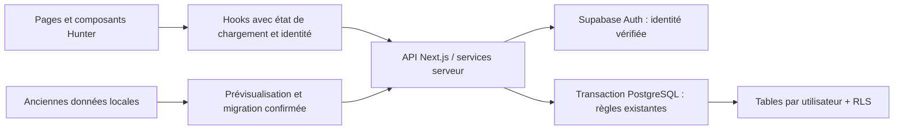

# AUTH-1 — Authentification obligatoire et progression Hunter dans le cloud

Date : 12 octobre 2026. **Orientation générale validée ; préparation sécurisée AUTH-2, aucune implémentation.** Références : AGENTS.md, prompt « LIFEQUEST — AUTHENTIFICATION OBLIGATOIRE ET PROGRESSION HUNTER » fourni dans cette session, `PERSISTENCE_MIGRATION_PLAN.md`, `F05_FINAL_VALIDATION.md`, `F06_CI_DEPENDENCY_REPORT.md` et code actuel. Cette révision intègre le choix de reprise historique avant l'introduction et précise les preuves nécessaires au choix du moteur transactionnel.

Ce plan remplace les propositions de **mode invité** du précédent plan de migration : le produit final exige un compte pour toutes les fonctionnalités métier. L'adaptateur local sera réservé à la récupération et au transfert de données historiques, jamais proposé comme alternative de gameplay à une connexion échouée.

## 1. État vérifié du projet et périmètre

Next.js 16.4.0, React/React DOM 19.3.0, TypeScript 5.9.3, App Router. Aucun package Supabase ni serveur de compte présent dans `frontend/package.json`. Les pages sont principalement clientes ; aucune vérification d'identité serveur, table PostgreSQL ou politique RLS active.

| Zone actuelle | Observation et conséquence |
| --- | --- |
| `frontend/src/app/page.tsx` | Redirection fondée sur le profil ou la présence de clés locales : à remplacer par le routage authentifié, pas une preuve d'identité. |
| `src/components/system/SystemShell.tsx` sous frontend | Garde client du profil ; les anciens comptes avec XP peuvent accéder sans profil. Aucun compte Supabase. |
| `src/components/onboarding/OnboardingExperience.tsx` | Cinq étapes React, brouillon en mémoire, introduction à l'étape 0. Seul le profil final est enregistré. Ne pas prétendre pouvoir reconstruire un ancien brouillon perdu. |
| `src/lib/profile.ts` | Nom, âge, genre, avatar, objectifs textuels et `onboardingCompleted` ; aucune association à un UUID Auth. |
| `src/app/activation/page.tsx` | Vidéo d'activation après sauvegarde du profil ; aucun statut durable de visionnage de cette vidéo. |
| `src/components/cinematics/LevelCinematicGate.tsx` | Vidéos existantes aux niveaux 5, 10 et 20, première admissible non consommée ; marqueurs locaux liés à createdAt/nom et Set en mémoire. Aucun historique fiable d'introduction/activation. |
| `src/components/cinematics/CinematicPlayer.tsx` | Fin, passage et fermeture déclenchent onComplete ; ne pas confondre un passage volontaire avec une vidéo regardée entièrement. |
| `src/components/hunter/HunterTransition.tsx` | Présentations d'évolution tous les cinq niveaux, changements de rang et marqueur local du niveau présenté. Distinct des vidéos 5/10/20. |
| `src/lib/characterEvolution.ts`, `hunterMissions.ts` | Portraits évolutifs et rangs dérivés du niveau ; pas de classes RPG métier à inventer. |
| `src/lib/hunterCore.ts`, `questActions.ts`, `activityRewards.ts` | XP centralisés, reçus de quêtes/Focus/Boss, achievements idempotents, compatibilités F03/F04. Domaine encore mêlé à localStorage. |
| `src/lib/useQuestSystem.ts`, `useStoredData.ts` | Snapshots/caches et notifications du navigateur ; à isoler par utilisateur et convertir en chargement cloud explicite. |
| `src/lib/importJournal.ts`, `importRecovery.ts`, `storageAccess.ts` | F05 : blocage sur journal présent, reprise contrôlée. Durabilité immédiate non garantie ; aucune atomicité native de localStorage. |

Tous les chemins abrégés `src/...` ci-dessus sont sous `frontend`.

**Évolution 01 préservée :** sept fichiers déjà modifiés et non commités au début de cet audit : `frontend/README.md`, `frontend/scripts/browser-check.cjs`, `frontend/src/app/quests/page.tsx`, `frontend/src/components/system/QuestRows.tsx`, `frontend/src/lib/questActions.ts`, `frontend/src/lib/useQuestSystem.ts`, `frontend/tests/lifequest012.test.cjs`. Les actions archive/restauration conservent l'ID et les reçus, incrémentent revision seulement lors d'une transition réelle et sont protégées par Web Locks. Aucun de ces fichiers n'est modifié par AUTH-1.

Les résultats 178 tests et 67 observations Chrome appartiennent à l'Évolution 01 ; **ils ne sont pas réexécutés ni remplacés par des tests Supabase dans AUTH-1**. Aucun SQL/RLS ci-dessous n'est exécuté.

## 2. Décision d'architecture

Conserver App Router et l'interface Hunter ; retenir **Supabase Auth + PostgreSQL Supabase**, avec clients SSR serveur/navigateur et une couche serveur de commandes métier. Les bibliothèques SSR/SDK et un pilote PostgreSQL seront choisis/vérifiés en AUTH-2, sans changement anticipé des versions Next/React.



### 2.1 Comparaison des moteurs transactionnels

**Les deux options sont documentées comme réalisables, mais aucune n'est testée dans ce projet.** Aucun hébergement cible ni projet Supabase de développement n'est configuré pour ces essais. Le SDK et le pilote PostgreSQL sont absents ; aucune connexion, politique ou fonction proposée n'a été exécutée. La faisabilité documentaire ne constitue pas une validation du rôle, du pool ou des transactions en production.

| Critère | Connexion PostgreSQL depuis Next.js | RPC PostgreSQL via Supabase/PostgREST |
| --- | --- | --- |
| Transaction | Même client réservé de BEGIN à COMMIT/ROLLBACK ; calcul TypeScript entre les requêtes | Un appel RPC POST contenant toute la commande ; les appels HTTP séparés restent des transactions distinctes |
| Règles RPG | Réutilisation des fonctions TypeScript pures après verrou | Règles critiques dans la fonction SQL ; tests de parité obligatoires pour éviter un drift avec TypeScript |
| Identité | Next vérifie le JWT et construit le contexte SQL ; identifiant de connexion serveur sensible | JWT de l'utilisateur transmis à la Data API, validation par PostgREST ; aucune service_role de gameplay |
| RLS | Rôle runtime limité et contexte local à la transaction | Rôle utilisateur pour les lectures ; rôle propriétaire limité des fonctions de commande pour les écritures |
| Hébergement | Node.js avec pilote compatible, TCP/TLS, réseau et budget de connexions validés | HTTPS, pas de pool applicatif PostgreSQL à gérer ; timeouts API et taille des commandes restent à tester |
| Risque particulier | Fuite de contexte du pool ou credential runtime compromis permettant l'usurpation d'UID | Fonction SECURITY DEFINER trop privilégiée ou commande directe RPC contournant les contrôles uniquement placés dans Next |
| Coût | Gestion des connexions/annulations et extraction du domaine pur | Portage des invariants en SQL, migrations des fonctions et parité durable |

PostgREST ouvre une transaction par requête ; une RPC de mutation doit être appelée en POST et être VOLATILE. Une erreur non absorbée annule la transaction. Le bootstrap doit lui aussi fournir un snapshot cohérent, par transaction de lecture appropriée ou requête RPC agrégée ; plusieurs lectures HTTP indépendantes ne suffisent pas. [Transactions PostgREST](https://docs.postgrest.org/en/stable/references/transactions.html).

**Recommandation conditionnelle :** privilégier l'évaluation RPC pour un déploiement serverless lorsque l'on souhaite éviter les credentials PostgreSQL runtime et la gestion du pool. Conserver l'option Next.js + PostgreSQL si la réutilisation des règles TypeScript est déterminante et que les essais d'hébergement, de rôle et d'isolation réussissent. Aucun moteur n'est définitivement retenu ici : le choix sera documenté après les essais ciblés d'AUTH-2 et avant les commandes métier AUTH-4. Ne pas développer deux chemins de mutation concurrents ni remplacer une option échouée par service_role.

### 2.2 Conditions de sûreté de la connexion PostgreSQL

Un serveur Next.js Node persistant peut utiliser une connexion directe si le réseau est compatible ; un déploiement serverless doit évaluer le pooler en mode transaction. Le mode transaction ne supporte ni prepared statements ni pipelining : désactiver ces fonctionnalités dans le pilote choisi, sans renoncer aux paramètres SQL. Vérifier IPv4/IPv6 et prendre les endpoints dans le Dashboard, sans déduire le hostname de la région. Dimensionner le pool par instance et le nombre total d'instances ; garder les transactions courtes. [Modes de connexion Supabase](https://supabase.com/docs/guides/database/connecting-to-postgres).

Le rôle runtime `lifequest_server` doit disposer de LOGIN ou d'un login dédié limité, sans SUPERUSER, BYPASSRLS, propriété des tables, droits de migration ou appartenance à un rôle privilégié. Vérifier réellement son authentification sur le pooler choisi, current_user/session_user, ses grants et ses accès aux helpers Auth. Ne pas utiliser le login postgres suivi de SET ROLE comme séparation des privilèges. Les migrations disposent d'identifiants distincts, absents du runtime. Les rôles avec login personnalisé sont possibles dans PostgreSQL Supabase, mais leur fonctionnement dans notre configuration doit être testé. [Rôles Supabase](https://supabase.com/docs/guides/database/postgres/roles).

Après vérification serveur de signature, issuer/audience, expiration, sub et session, passer seulement les claims nécessaires par requête paramétrée à `set_config('request.jwt.claims', ..., true)`, **après BEGIN et sur le même client**. Ni auth.uid() ni set_config ne vérifient cryptographiquement un JWT : le serveur est la frontière de confiance. Une compromission du credential runtime permettrait de fabriquer ce contexte ; RLS ne suffit pas à empêcher cette usurpation. Ne jamais choisir un rôle SQL à partir du payload ou de claims non vérifiés.

Tester A → COMMIT → B puis A → ROLLBACK → B sur le même client, absence d'identité exploitable hors transaction, requêtes concurrentes, timeout et connexion interrompue. Un client dont l'état transactionnel est incertain est détruit, jamais rendu au pool. Pas de SET de session persistant ; TLS avec certificat vérifié, secrets exclusivement serveur. Les settings transactionnels peuvent devenir une chaîne vide après commit : les helpers doivent traiter cet état comme absence d'identité. [Contexte transactionnel PostgREST](https://docs.postgrest.org/en/stable/references/transactions.html).

### 2.3 Conditions de sûreté de l'option RPC

Next vérifie la session, puis appelle la RPC avec un client par requête, clé publishable et JWT de cet utilisateur. Le contrôle SQL reste nécessaire puisque l'utilisateur peut appeler la Data API directement. La fonction reçoit une intention, expected_actor/revision et request_id ; jamais un montant final d'XP, un niveau ou un UID à croire sur parole.

SECURITY INVOKER est le défaut recommandé. Cependant il ne permet pas une mutation si authenticated n'a aucun DML sur les tables, comme exigé ici. Pour une commande RPC, évaluer une fonction SECURITY DEFINER détenue par `lifequest_command_owner`, NOLOGIN, sans BYPASSRLS ni propriété des tables, avec seulement les grants métier nécessaires et les politiques RLS correspondantes. Vérifier auth.uid(), session et appartenance dans la fonction aussi. Propriétaire postgres interdit pour ces commandes. Objets qualifiés, search_path vide, EXECUTE retiré à PUBLIC/anon et accordé à authenticated uniquement sur les commandes prévues ; contrôler aussi les privilèges par défaut des futures fonctions et les schémas exposés. [Sécurisation des fonctions Supabase](https://supabase.com/docs/guides/database/functions).

Une commande regroupe verrou Hunter, contrôle des révisions, calcul fiable, écritures, reçu unique et résultat. Ne pas absorber une exception pour renvoyer success après une écriture partielle. Tests directs Data API : utilisateur A ne peut agir sur B, définir lui-même ses XP ni invoquer un helper privé ; faute au milieu = aucune écriture ; retry après réponse perdue = même reçu. Le rôle propriétaire doit rester soumis à RLS : FORCE RLS ne neutralise pas SUPERUSER/BYPASSRLS. [RLS PostgreSQL](https://www.postgresql.org/docs/current/ddl-rowsecurity.html).

Supabase demeure l'autorité des mots de passe, confirmations et sessions. PostgreSQL demeure l'autorité de la progression. React ne fournit que l'état de présentation. Les readers cloud renvoient des DTO compatibles avec les modèles actuels, sans transformer une erreur réseau en emptySystem.

## 3. États, chargement et isolation du navigateur

Deux machines d'état séparées :

- Auth : `checking`, `signed_out`, `confirmation_required`, `authenticated`, `refreshing`, `expired`, `error`.
- Hunter : `loading`, `origin_choice_pending`, `introduction_pending`, `onboarding_pending`, `activation_pending`, `ready`, `migration_pending`, `recovery_required`, `error`.

`authenticated` seul ne suffit pas à monter le dashboard. Le bootstrap serveur vérifie l'identité, la session, la présence du compte et charge un snapshot cohérent sous transaction de lecture. Il renvoie actor UUID, revision du compte, progression, profil, tous les modules et présentation. Une lecture échouée, un compte attendu absent ou un snapshot incohérent produit une erreur/reprise ; **jamais une création implicite à zéro**.

La création initiale sera une opération provisionnée à l'inscription : trigger minimal sur auth.users créant une enveloppe à 0 XP et les checkpoints initiaux, transactionnel et idempotent, sans interpréter user_metadata comme des permissions. Cette enveloppe ne signifie pas que le choix nouveau/reprise est déjà fait. Un échec de provisioning doit être visible/testé et empêcher une inscription prétendument complète. La connexion n'exécute pas une routine de remise à zéro. Si la ligne Hunter manque après une inscription supposée réussie, proposer une réparation de provisioning explicite côté serveur ; aucune lecture locale de substitution.

Persister le choix d'origine dans `hunter_setup` : origin_choice nullable (`new`/`legacy`), revision, chosen_at, migration_id nullable. Toute transition est une commande authentifiée et contrôlée par révision. Un compte ready n'affiche pas ce choix à chaque connexion et ne peut pas être réinitialisé par ce mécanisme. Pour un compte neuf avec une source locale détectée, afficher le choix avant toute cinématique ; pour un compte sans source, continuer le parcours neuf avec un état serveur enregistré. Un choix legacy interrompu revient au statut de migration, pas à l'introduction. Tant qu'AUTH-6 n'est pas livré, ne pas proposer une reprise fictive ni forcer le parcours neuf : cette branche reste explicitement indisponible en staging.

À chaque changement d'identité : masquer immédiatement le métier, invalider les caches singleton actuels, notices, minuteurs, états de dialogue, Set sessionSeen et requêtes ; renouveler l'époque de session. Toute réponse contient l'acteur attendu et n'est appliquée que si UUID et époque correspondent toujours. Toute commande porte un `expected_actor` comme garde de cohérence, **pas comme preuve d'autorisation** : le serveur le compare au compte vérifié. Cela empêche une requête tardive de A d'être appliquée au compte B lorsque les cookies du navigateur ont changé et que les IDs texte peuvent être identiques.

Synchronisation inter-onglets par événements Auth/BroadcastChannel sans données RPG ni tokens ; revalidation serveur au focus/retour visible et avant toute mutation. Un onglet suspendu doit rester masqué à sa reprise tant que son identité n'est pas revalidée. Retour navigateur après déconnexion, changement A → B et réponses A retardées doivent être testés visuellement. Première version : **pas de cache cloud persistant ni de file d'écritures hors ligne**. Le local historique reste séparé, hors de ces readers.

Déconnexion : verrouiller/masquer le métier avant l'appel réseau, annuler les requêtes, vider la mémoire privée, invalider la session et les cookies, notifier les autres onglets, puis /login. Si la déconnexion distante échoue, rester verrouillé et proposer une reprise ; ne pas réafficher les données. Les anciennes sauvegardes locales ne sont pas effacées par ce nettoyage de mémoire.

## 4. Parcours obligatoires et routage

### Inscription neuve

`/` public → `/register` (e-mail/mot de passe) → attente de confirmation si configurée → `/auth/confirm` → bootstrap → choix d'origine si patrimoine local détecté → **Créer un nouveau Hunter** → introduction existante → onboarding repris par étape → activation existante → dashboard. Sans patrimoine local, le parcours neuf continue directement après bootstrap.

Alternative explicite sur ce même écran authentifié : **Récupérer ma progression locale** → récupération F05 si nécessaire → prévisualisation/export/consentement → transfert confirmé → chargement cloud → dashboard au niveau historique. Un profil historique terminé n'est pas forcé à refaire introduction/onboarding/activation ; les états non prouvés sont conservés comme historiques inconnus, jamais déclarés regardés entièrement. Un ancien Hunter sans profil valide complète seulement les informations manquantes, sans remise à zéro de ses XP. Aucun contenu local n'est dévoilé automatiquement au mauvais compte.

Après signup, une réponse sans session n'autorise pas l'accès métier. Les confirmations/réinitialisations suivent les flux SSR officiels, avec vérification serveur du token ou échange de code correspondant au flux choisi. Un lien expiré, déjà consommé ou ouvert sans le verifier PKCE requis mène à un état explicite/reprise, pas à un accès forcé. AUTH-3 doit tester les liens dans le navigateur d'origine et un autre navigateur. [Confirmation et mot de passe](https://supabase.com/docs/guides/auth/passwords), [PKCE](https://supabase.com/docs/guides/auth/sessions/pkce-flow).

Un vrai nouveau Hunter termine ce parcours avec **0 XP, niveau 1, rang E, attributs à zéro**, avatar choisi et objectifs enregistrés. Aucun crédit pour inscription, introduction, onboarding ou vidéos ; aucune quête/Boss de démonstration injectée. Créer le profil et les checkpoints ne réinitialise pas un compte existant. Les domaines choisis restent les textes actuels du profil.

### Connexion existante

`/login` → authentification → écran de chargement explicite → lecture Supabase/PostgreSQL complète et validée → dashboard au niveau actuel. XP, reçus, rang, avatar/évolution, attributs, quêtes actives/archivées, Arcs, Boss, Focus, achievements, Lab et historique de présentation sont rechargés. Aucun onboarding déjà terminé ni introduction consommée rejoué.

Un compte incomplet reprend seulement son checkpoint manquant. Le dashboard ready s'affiche d'abord ; les nouvelles vidéos admissibles non consommées peuvent ensuite être proposées dans l'ordre existant. Une connexion normale ne force pas un détour par une série de vidéos déjà vues.

| État serveur confirmé | Destination / comportement |
| --- | --- |
| Pas de session | /login pour toute route métier ; accueil public sans progression locale. |
| Confirmation requise | Écran d'attente, renvoi d'e-mail limité ; aucun gameplay. |
| Session valide, snapshot en cours | /auth/bootstrap ou boundary équivalente ; indicateur, aucune donnée du compte précédent. |
| Compte neuf, source locale détectée, choix non confirmé | Écran authentifié de choix nouveau/reprise, avant introduction ; aucune mutation RPG. |
| Choix legacy enregistré, transfert non terminé | Reprise du diagnostic/statut de migration ; aucune introduction forcée. |
| Parcours neuf, introduction non consommée, onboarding non terminé | /onboarding, étape introduction, reprise du dernier checkpoint vidéo confirmé. |
| Introduction consommée, onboarding incomplet | /onboarding, étape serveur correspondante et brouillon enregistré. |
| Parcours neuf ou checkpoint cloud connu, profil terminé, activation non consommée | /activation seulement ; ne pas refaire les formulaires. Un profil historique terminé avec legacy_unknown ne déclenche pas cette obligation. |
| Hunter ready | /dashboard ; accès authentifié aux autres routes métier. |
| Compte/snapshot absent ou incohérent | Écran d'erreur/récupération authentifié, pas d'initialisation vide. |
| Migration propre au compte engagée | Écran de statut ; mutations suspendues jusqu'à statut définitif. |
| Journal F05 local présent | Migration locale bloquée jusqu'à récupération ; ne pas utiliser ce snapshot pour initialiser le cloud. |

Routes publiques : `/`, `/register`, `/login`, `/forgot-password`, `/auth/confirm`. `/update-password` exige un contexte de récupération validé ; ce n'est pas un accès libre au Hunter. Routes métier protégées : dashboard, quests/create, quests, arcs, hunter-core, hunter-operations, hunter-lab, onboarding et activation. Vérification dans layouts/pages serveur **et chaque endpoint/action** ; Proxy pour refresh/redirection précoce, jamais seule défense.

Les paramètres next/returnTo ne déterminent ni l'identité ni le checkpoint. Redirections internes limitées à une liste connue, rejet de schémas externes, URLs `//...` et encodages de contournement. Une connexion normale d'un compte ready conduit au dashboard. Erreurs des formulaires accessibles, focus d'erreur, labels, pending, refus de double soumission ; aucun changement du thème Hunter. Reset password et renvoi de confirmation ne révèlent pas publiquement si une adresse existe. SMTP et redirect URLs exactes des environnements à configurer avant pilote.

## 5. Introduction, onboarding et cinématiques persistants

Cataloguer exclusivement les assets existants : `intro-sacrifice.mp4`, `player-activation.mp4`, vidéos de niveaux 5/10/20 (version optimisée + fallback au niveau 5). Codes stables : `intro-v1`, `activation-v1`, `level-5-v1`, `level-10-v1`, `level-20-v1`. Les variantes d'encodage d'un même clip ne créent pas deux visionnages. Les fichiers peuvent rester publics ; cela ne donne pas le droit de créditer un checkpoint ni ne prouve une autorisation métier.

`onboarding_progress` : étape nommée/version, brouillon validé JSONB, revision, updated_at, completed_at. Ne pas stocker uniquement l'index d'un tableau React. Enregistrer aux transitions et par sauvegarde de brouillon bornée ; avancer après réponse confirmée. Après reload, reprendre l'étape serveur. Des modifications non confirmées pendant une coupure peuvent nécessiter une nouvelle saisie ; aucun « sauvé » trompeur.

`cinematic_progress` par compte/code : position de reprise en secondes, `consumed_at`, `watched_completed_at`, outcome (`ended`, `skipped`, `error_dismissed`, `legacy_acknowledged`), revision. Checkpoint périodique borné et sur pause/fin ; sa fréquence est à valider, proposition cinq secondes. Le serveur valide le code, les bornes et le niveau admissible. Fin/passage/fermeture volontaire conservent la sémantique actuelle de consommation ; une erreur de chargement ne prétend pas qu'une vidéo a été regardée. Le player doit permettre de passer pour éviter de bloquer un compte sur un média indisponible. Les marqueurs sont monotones : pas de passage de consommé à non consommé lors d'un login/retry.

Ne plus faire de sessionSeen ou du nom/avatar une source de vérité. Reprendre les vidéos 5 → 10 → 20 selon le niveau réel, en ignorant celles consommées ; aucun rattrapage artificiel de clips inexistants. Les présentations d'évolution à tous les paliers de cinq sont distinctes (`presentation_state`/événements), avec consommation idempotente. L'avatar est dérivé du profil et du niveau, pas choisi dans une réponse cliente arbitraire.

Historique local : un marker `1` prouve une consommation selon l'ancien player, **pas un visionnage intégral**. Introduction et activation historiques ne sont pas reconstructibles. Pour un profil ancien terminé, conserver `legacy_unknown` pour ces états et ne pas imposer de nouvel onboarding/intro ; proposer un replay volontaire seulement si demandé. Pour les marqueurs de niveau, rattacher uniquement le préfixe correspondant sans ambiguïté au profil importé ; plusieurs préfixes inconnus sont conservés dans le brut et diagnostiqués, pas attribués arbitrairement.

## 6. Schéma PostgreSQL proposé

Convention : Auth UUID immuable comme `user_id`; IDs métier **text**, y compris UUID textuels et IDs historiques non UUID. PK `(user_id,id)` pour les collections. Dates absolues `timestamptz`, jours `date`, périodes historiques conservées en text. Révisions bigint pour les opérations nouvelles ; valeurs historiques hors plage sûre à diagnostiquer, sans troncature. Toutes les relations actives utilisent des FK composées incluant user_id. Aucun ON DELETE CASCADE sur les crédits historiques à la suppression d'une quête/Arc.

| Table | Colonnes principales et invariants |
| --- | --- |
| hunters | user_id PK/FK auth.users, total_xp numeric, opening_xp numeric, legacy_roundoff_delta numeric, timezone IANA, rules_version, revision, created_at ; initialisation 0, niveau/rang dérivés. |
| hunter_setup | user_id PK, origin_choice nullable new/legacy, chosen_at, migration_id nullable, revision ; pas de reset de compte configuré, décision avant introduction. |
| hunter_profiles | user_id PK, name, age, gender, avatar, goals text[], original_created_at ; champs finaux validés comme profile.ts, profil draft possible séparément. Pas de mot de passe/e-mail dupliqué comme preuve d'identité. |
| onboarding_progress | user_id PK, schema_version, step, draft jsonb, revision, completed_at. |
| cinematic_progress | PK(user_id,cinematic_code), resume_seconds, outcome, consumed_at, watched_completed_at, revision ; catalogue fermé. |
| presentation_state | user_id PK, last_transition_level, intro_legacy_unknown, activation_legacy_unknown ; ordre des présentations dérivé, pas de nouveau niveau. |
| story_arcs | PK composite, title, description, target_date, created_at, revision. |
| quests | PK composite, arc_id nullable avec FK composite, title, description, frequency, difficulty, attribute, base_xp, archived, created_at, target_date, available_after, revision. |
| xp_events | PK composite, legacy_quest_id/source_ref text, source_kind, source_id text, period_key, awarded_xp numeric, attribute, occurred_at, title_snapshot, arc_id_snapshot, provenance ; UNIQUE(user_id,legacy_quest_id,period_key). |
| achievement_unlocks | PK(user_id,achievement_id), unlocked_at ; six IDs actuels, pas d'XP supplémentaire. |
| boss_missions | PK composite, title, objective, mode counter/weighted, target/current, base_xp, completed_at, reward_status, revision. |
| boss_subobjectives | PK composite, boss_id FK composite, title, weight, completed ; poids/bornes actuels, totaux dérivés et vérifiés. |
| focus_sessions | PK composite, occurred_at, minutes, label, reward_status historique nullable ; crédit once via reçu. |
| focus_runs | PK composite, état du minuteur, elapsed actif, running_since, mode, label, revision ; temps futur contrôlé serveur, reprise explicite, un identifiant stable partagé pour une même session. |
| system_events | PK composite, kind boss/rank/evolution, title, detail, occurred_at ; distinct des crédits. |
| ideas | PK composite, title, content, tag, archived, created_at. |
| mind_nodes | PK composite, parent_id FK composite nullable, title, x/y ; contrôle de cycle et reparenting transactionnels. |
| resources | PK composite, title, notes, url HTTP(S), topic, mastered, created_at. |
| journal_entries | PK composite, local_date, wins/challenges/gratitude/tomorrow ; UNIQUE(user_id,local_date). |
| creativity_challenges | PK composite, prompt, response, occurred_at, completed ; aucune nouvelle règle DAILY. |
| hunter_settings | user_id PK, baseline et historique de pénalités conservés ; stabilité fonctionnelle 100, aucune pénalité réactivée. |
| command_receipts | PK(user_id,request_id), command_kind, payload_hash, minimal_result, committed_at ; même ID avec payload différent refusé. |
| migration_batches | PK(user_id,migration_id), source_hash, status prepared/validated/committed/failed, target_revision, manifest, validated_at, committed_at ; unicité de source déjà importée par compte. |
| migration_sources | installation_id unique, owner_uid, claim_status ; liaison explicite du patrimoine local à un destinataire, pas une preuve d'identité ni un accès au compte. |
| migration_snapshots (schéma privé) | user_id, migration_id, raw_records JSONB de chaînes originales, hash, expires_at ; accès serveur limité, aucune exposition publique. |

Les source_ref des reçus ne portent pas de FK obligatoire vers des activités : des reçus légitimes sont orphelins. Une FK documentaire d'arc détruirait l'historique d'un Arc supprimé : conserver son identifiant snapshot. Préserver les champs absents/null et les données historiques brutes utiles à l'export. Indexer user_id, quêtes (user_id,archived,frequency), crédits (user_id,occurred_at), périodes et FK.

Extrait **illustratif, non exécutable comme migration complète** :

```sql
create table public.story_arcs (
  user_id uuid not null references auth.users(id),
  id text not null,
  title text not null,
  description text not null,
  target_date date not null,
  created_at timestamptz not null,
  revision bigint not null default 0 check (revision >= 0),
  primary key (user_id, id)
);
create table public.quests (
  user_id uuid not null references auth.users(id),
  id text not null,
  arc_id text,
  title text not null,
  description text not null,
  frequency text not null check (frequency in ('daily','weekly','monthly','once')),
  difficulty text not null check (difficulty in ('EASY','NORMAL','HARD')),
  attribute text not null check (attribute in ('focus','discipline','knowledge','energy','consistency')),
  base_xp numeric not null check (base_xp >= 0 and base_xp <= 300),
  archived boolean not null default false,
  created_at timestamptz not null,
  target_date date,
  available_after date,
  revision bigint not null default 0 check (revision >= 0),
  primary key (user_id, id),
  foreign key (user_id, arc_id) references public.story_arcs(user_id,id)
);
create table public.xp_events (
  user_id uuid not null references auth.users(id),
  id text not null,
  legacy_quest_id text not null,
  source_kind text not null,
  source_id text not null,
  period_key text not null,
  awarded_xp numeric not null check (awarded_xp >= 0 and awarded_xp < 'Infinity'::numeric),
  attribute text not null,
  occurred_at timestamptz not null,
  title_snapshot text,
  arc_id_snapshot text,
  provenance text not null,
  primary key (user_id,id),
  unique (user_id,legacy_quest_id,period_key)
);
```

Les contraintes finales reprennent les validateurs existants (dont enums, bornes, NaN/infini, IDs, timestamps, cohérence F03/F04), et sont testées sur les imports historiques. La suppression d'Arc met les liens actifs à null dans la même transaction avant suppression, comme le comportement actuel ; les reçus restent inchangés.

**XP historiques :** aucun arrondi ni reconstruction depuis les seules validations. Solde d'ouverture = total local moins crédits détaillés, sans addition du miroir legacy. PostgreSQL numeric préserve les valeurs décimales ; les soldes et montants doivent rester représentables par le DTO existant. `validState` tolère de minuscules erreurs IEEE de somme. Si un reliquat négatif est uniquement dans cette tolérance, le plan propose un `legacy_roundoff_delta` signé, documenté et strictement réservé à la migration, pour conserver à la fois total et reçus. Cette politique doit être validée avant AUTH-6 ; sinon le cas est bloqué en staging, jamais corrigé silencieusement. Une différence réelle reste un refus.

Le total stocké est mis à jour avec le reçu dans la transaction ; comparaison de cohérence avec opening_xp + crédits + éventuel delta d'import. Niveau : coût 200 + 25 × (n−1), plafond 100. Rangs : E/D/C/B/A/S aux niveaux 1/10/20/30/40/50. Attributs : somme des XP des reçus par attribut, aucune répartition inventée du solde ancien sans détails.

## 7. Sécurité, sessions et RLS

Utiliser des clients SSR par requête et le mécanisme de refresh recommandé pour Next 16 (`proxy.ts` à confirmer avec la documentation de la version installée). Vérifier cryptographiquement les claims ; utiliser getUser pour les contrôles nécessitant l'état utilisateur actuel. Ne jamais autoriser une page/commande à partir de getSession, d'un cookie lu sans vérification ou d'un flag React. Les cookies rafraîchis doivent suivre toutes les réponses/redirections. [Documentation SSR officielle](https://supabase.com/docs/guides/auth/server-side/creating-a-client).

Désactiver les inscriptions anonymes Supabase ; refuser aussi les sessions Auth anonymes déjà existantes. Retirer les droits SQL du rôle anon. Pour confirmation obligatoire, le serveur exige un utilisateur confirmé, pas un booléen fourni par le navigateur. Utiliser HTTPS, cookies Secure/SameSite adaptés, CSP et prévention XSS ; ne pas promettre HttpOnly pour les cookies partagés avec le SDK navigateur SSR. Une architecture Auth exclusivement BFF/HttpOnly serait une variante à choisir explicitement, pas une propriété automatique de @supabase/ssr.

Chaque table utilisateur exposée : ENABLE RLS + FORCE RLS, grants minimaux, lecture uniquement du propriétaire. Les utilisateurs authenticated n'ont **aucun DML direct**, même sur leurs propres XP/statuts ; toutes les mutations passent par le service transactionnel ou les RPC contrôlées de l'option retenue. Le rôle de mutation (`lifequest_server` ou `lifequest_command_owner`) n'est pas propriétaire des tables et reste soumis aux politiques. Tests au rôle réel, pas uniquement avec postgres/service_role. RLS et grants se complètent ; protéger aussi vues, fonctions et tables de staging. [RLS Supabase](https://supabase.com/docs/guides/database/postgres/row-level-security), [RLS PostgreSQL](https://www.postgresql.org/docs/current/ddl-rowsecurity.html).

Modèle de politiques pour quests **pour l'option connexion PostgreSQL** (le rôle serveur et helper sont à définir/tester en AUTH-2). Pour RPC, adapter le rôle de mutation à lifequest_command_owner et les droits EXECUTE suivant §2.3 ; ce SQL n'est pas une migration commune aux deux options :

```sql
alter table public.quests enable row level security;
alter table public.quests force row level security;
revoke all on public.quests from anon, authenticated;
grant select on public.quests to authenticated;
grant select, insert, update on public.quests to lifequest_server;
create policy quests_read on public.quests for select
to authenticated, lifequest_server
using ((select auth.uid()) = user_id and (select private.session_allowed()));
create policy quests_insert on public.quests for insert to lifequest_server
with check ((select auth.uid()) = user_id and (select private.session_allowed()));
create policy quests_update on public.quests for update to lifequest_server
using ((select auth.uid()) = user_id and (select private.session_allowed()))
with check ((select auth.uid()) = user_id and (select private.session_allowed()));
```

La même matrice s'applique aux autres tables, sans DML client sur profile/onboarding/cinématiques : les flags de présentation ne sont pas des permissions modifiables directement. Les suppressions Lab autorisées utilisent une politique serveur distincte ; aucun DELETE libre sur quêtes ou crédits. Les views doivent respecter RLS (security_invoker si adapté) ; aucun analytics global exposé. Fonctions SECURITY DEFINER éventuelles : propriétaire à privilèges minimaux, search_path vide, objets qualifiés, EXECUTE retiré à PUBLIC/anon, paramètres validés, pas de SQL dynamique sur payload.

`private.session_allowed()` doit refuser auth.uid nul, JWT expiré, utilisateur anonyme et session révoquée. Pour détecter une déconnexion malgré un access token encore valide, vérifier session_id contre auth.sessions avec une fonction de lecture étroitement privilégiée, sans accès client à cette table. Les cookies/JWT sont vérifiés avant construction du contexte PostgreSQL. La durée maximale/inactivité nécessite aussi les contrôles Auth applicables : la présence d'une ligne session seule n'en prouve pas la fraîcheur. Ne pas supposer que getClaims invalide instantanément un JWT déconnecté. [Sessions Supabase](https://supabase.com/docs/guides/auth/sessions).

Les réponses personnelles, tokens, snapshots et redirects auth ne sont jamais mis en cache partagé/CDN : Cache-Control private/no-store et absence de caches Next sans clé d'utilisateur. Ne pas précharger une route Hunter avant propagation des nouveaux cookies. Seuls URL/key publishable Supabase peuvent être publics. Identifiants PostgreSQL et secret/service_role restent exclusivement serveur ; service_role limité aux opérations administratives, pas au gameplay. Logs sans mots de passe, cookies, JWT, e-mail complet, journaux ou exports. CSRF/Origin sur commandes à cookies, requêtes paramétrées, limites de taille/fréquence, SMTP fiable et redirections allowlist. Les tests doivent tenter l'accès direct à la Data API, pas seulement l'UI.

## 8. Transactions métier et conservation F01–F05

Pour chaque commande avec connexion PostgreSQL : identité/session vérifiée → BEGIN → contexte UID local → verrou `hunters ... FOR UPDATE` → receipt de request_id/payload_hash → lecture des entités/révisions → calcul pur actuel → écritures et receipt → revision globale → COMMIT. Avec RPC, ces étapes métier sont regroupées dans une seule fonction et transaction, le contexte venant de PostgREST ; la parité des calculs doit être démontrée. Toutes les commandes prennent les verrous dans le même ordre. Les contraintes uniques restent la dernière défense contre la concurrence. La réponse perdue après commit est résolue par interrogation/reprise du même request_id, jamais par répétition aveugle d'une récompense. [Transactions PostgreSQL](https://www.postgresql.org/docs/current/tutorial-transactions.html).

- F01 : pending/verrou UI conservés ; request_id stable pour une intention de création. Deux intentions distinctes de même titre restent permises.
- Évolution 01 : archive/restauration par même ID, états idempotents, revision incrémentée une fois, aucun XP/reçu modifié. Rejet des éditions attendues périmées, aucun écrasement du brouillon.
- Complétion : date serveur dans le fuseau confirmé du Hunter, period_key existant, contraintes de crédit par période. Conservation des cooldowns et de la règle once déjà terminée. Bonus calculé après verrou, avant crédit comme actuellement.
- F02 : parent valide et contrôle de cycles/reparenting dans la transaction, conservant les brouillons et les liens de même compte.
- Boss : dernier sous-objectif, événement et récompense atomiques ; reçu once unique. F03 `resolved_without_xp` est une résolution terminale d'ancien Boss à zéro, sans reçu fictif ni XP ; un credited exige une preuve positive appropriée.
- Focus : timestamps/durée contrôlés serveur pour les nouvelles sessions, pause/reprise avec ID stable ; un timer importé expiré n'accorde jamais spontanément une récompense. Sessions historiques sans statut gardées selon F04.
- F04 : validation inter-modules avant staging/commit, reçus importés référence historique, orphelins admissibles conservés. Aucun recalcul de leurs bonus, titres ou attributs.
- F05 : conserver les clés, validateurs, journaux et confirmations pour les données historiques. Les commandes cloud n'écrivent pas ces clés et ne simulent pas une transaction cloud avec Web Locks. La restauration distante complète est transactionnelle, sous confirmation et revision cible ; aucune réparation silencieuse.

Réseau indisponible : pas de mutations optimistes XP ni fallback local. État clairement indisponible, dernier brouillon serveur repris quand la même identité revient. Timeout : issue unknown, query receipt avant retry. Session expirée : métier masqué, réauthentification, reprise seulement pour le même UUID ; aucune requête de A rejouée pour B. Les changements locaux non sauvegardés en mémoire peuvent être perdus au nettoyage de session ; prévenir et sauvegarder les checkpoints avant progression, sans conserver du texte de A dans le navigateur de B.

## 9. Migration des anciennes données locales

**Pas d'import automatique à l'inscription/connexion.** Après authentification et bootstrap d'un compte non configuré, détecter l'existence d'une source locale sans afficher son contenu. Proposer **A. Créer un nouveau Hunter** ou **B. Récupérer ma progression locale**, avant l'introduction. A suit introduction → onboarding → activation → niveau 1/E/0 ; B suit la prévisualisation et le transfert confirmé sans refaire les étapes historiques déjà terminées. Le provisioning à zéro est seulement une enveloppe cible, jamais un remplacement de la progression locale. Le choix A conserve également les données locales ; il n'autorise aucune fusion ultérieure automatique. Un compte cloud déjà configuré se connecte directement à sa progression, même si d'autres clés locales sont présentes.

1. Détecter seulement l'existence du patrimoine local, sans l'afficher à un compte différent déjà associé. Une source non authentifiée historiquement ne prouve pas son propriétaire : demander confirmation explicite, ne jamais associer par nom/e-mail/avatar.
2. Garder Auth fonctionnel même si un journal local F05 bloque les données historiques. Pages register/login ne lisent pas le snapshot RPG local. Déplacer la boundary legacy autour de récupération/migration, pas autour des pages d'identité. Cette séparation ne contourne pas F05 : aucun lecteur/écrivain local métier n'est autorisé sur un journal présent et aucune donnée partielle n'est transférée.
3. Si journal présent/corrompu/inconnu ou stockage inaccessible, récupération F05 explicite seulement ; aucun effacement. Le cloud déjà valide d'un autre compte ne doit pas être remplacé ni initialisé depuis cette source.
4. Sous Web Lock, capturer les records bruts ; export externe métier si possible et diagnostic distinct sinon. Hash des clés triées + valeurs brutes, sans exportedAt, pour stabiliser les retries. Ne pas upload un diagnostic comme backup métier.
5. Prévisualiser compte destinataire vérifié, total XP, niveau dérivé, nombre de quêtes/archives/reçus/achievements, Boss, Focus, Arcs, Lab, markers et anomalies. Validation v1/v2/F03/F04 serveur, limites de fichier et précision contrôlées.
6. Réserver installation/migration à ce UUID par consentement. La liaison locale n'est pas une preuve serveur ; toutes les opérations vérifient l'acteur. Après liaison à A, B n'a ni accès automatique au preview de A ni proposition de transfert silencieux. Un import volontaire de fichier demande une autorisation séparée et n'authentifie pas l'auteur de son ancien contenu.
7. Cible admissible : zéro XP, aucun reçu/quête/Arc/Boss/session/Lab/achievement nouveau ; un profil/checkpoint initial créé à l'inscription est permis. Toute progression déjà acquise bloque la migration initiale. Montrer explicitement quels champs de profil seraient remplacés ; aucun rapprochement/fusion de deux Hunters.
8. Staging privé persistant (`migration_id`, hash, manifest, snapshot). IDs, receipts, dates/périodes, archives/restaurations/revisions, XP personnalisés et statuts conservés. Legacy seule : reprendre la règle actuelle de legacyXP, sans recréer les quêtes de démonstration. Ancien baseline conservé comme historique, jamais additionné au solde. Minuteur brut archivé ; reprise cloud explicitement contrôlée, pas de crédit automatique.
9. Préserver l'état de présentation déjà terminé sur le compte d'accueil ; importer les markers historiques identifiables avec outcome legacy_acknowledged. Un profil historique validé avec onboardingCompleted permet la reprise sans refaire les formulaires et sans imposer introduction/activation ; leur historique non prouvé reste legacy_unknown. Si le profil manque, demander seulement les informations nécessaires à configurer le Hunter, sans effacer les XP ni imposer le parcours neuf complet. Ne pas reconstruire un brouillon perdu. Les vidéos 5/10/20 consommées importées ne sont pas rejouées lors de la connexion suivante ; les marqueurs ambigus ne sont pas attribués arbitrairement.
10. Avant confirmation, revérifier hash local et revision/éligibilité cible sous verrou. Réserver/bloquer les commandes de ce compte pendant commit ; transaction unique insérant tous les modules, crédits, solde, états, receipt de migration et statut committed. Hash différent ou écriture cloud concurrente : refus/repréparation, pas de fusion.
11. Réponse perdue : interroger le statut avec le même migration_id ; si committed, vérifier le manifeste/snapshot serveur ; si failed, retry contrôlé ; jamais recliquer avec un nouvel ID pour doubler le transfert.
12. Comparer avant/après : XP, IDs/périodes/XP des reçus, dates, révisions, archives, titres, sous-objectifs, contenus Lab, présentation. Export serveur compatible v1/v2 pour les données métier. Les nouveaux checkpoints Auth ne doivent pas être ajoutés comme clés inconnues aux backups v1/v2 ; leur sauvegarde complète repose sur les tables/backup cloud, une extension d'export éventuelle est une décision séparée.
13. Basculer readers vers le cloud seulement après preuve de commit et contrôle de parité. Conserver données/export locaux ; pas de suppression automatique après transfert ni après logout. Les nouveaux clients les traitent comme archive readonly, jamais comme gameplay invité. Une ancienne version encore ouverte peut continuer à les modifier : détecter le fork de hash, conserver ces différences, refuser une seconde migration automatique.

Proposition de rétention à valider : staging non confirmé 24 h, brut d'une migration confirmée sept jours avant purge contrôlée ; manifests/receipts nécessaires à l'idempotence conservés. Les exports externes restent sous contrôle utilisateur. Snapshot privé et logs sont des données personnelles ; ne pas les publier en artefacts CI.

Après des écritures cloud, revenir à un vieux snapshot local perdrait la progression récente : aucun rollback automatique vers local. Prévoir snapshot serveur, export et procédure de restauration testée, avec source de vérité unique. SQL n'empêche pas l'effacement des données du navigateur ni ne récupère un journal F05 perdu avant transfert.

## 10. Roadmap AUTH-2 à AUTH-6

Chaque phase nécessite une validation distincte ; aucune n'est commencée par ce document. Les phases intermédiaires sont des validations de développement/staging, pas un produit déployé avec un accès invité résiduel.

| Phase | Livrables ciblés | Critères d'acceptation et tests |
| --- | --- | --- |
| AUTH-2 — Fondations Supabase | Environnements séparés, SSR clients/Proxy, variables documentées sans secrets, migrations versionnées, compte minimal/trigger, rôle runtime/pool et RLS, helper session | Base jetable ; nouveau compte à 0 une seule fois ; erreur de trigger visible ; tests SQL avec anon/A/B/runtime ; A ne lit/modifie aucun ID de B ; DML direct XP/flags interdit ; contexte pool A→B isolé ; JWT forgé/expiré/session révoquée refusé ; aucune clé privée dans bundle. CI existante conservée. |
| AUTH-3 — Inscription/connexion | /register, /login, /forgot-password, /update-password, /auth/confirm, logout et guard serveur | Tests e-mail confirmé/non confirmé, doublons et soumissions multiples, liens expirés/reutilisés/autre navigateur, reset, open redirect/CSRF, accès direct route/action, logout/retour navigateur, cookies refresh. Tant que cloud non relié, afficher bootstrap/en construction authentifié ; ne jamais afficher les anciennes données locales comme compte connecté. |
| AUTH-4 — Sauvegarde cloud | Contrat asynchrone, domain pur, transactions, readers tous modules, receipts/exports, caches par UID | Tests de parité XP/niveaux/statistiques ; toutes entités persistées et relues ; restore archive daily/weekly/monthly/once, révisions concurrentes, titres identiques volontaires ; concurrence quêtes/Boss/Focus/achievements ; erreur au milieu rollback total ; timeout après commit même receipt ; changement A→B et réponse A tardive refusée ; aucune mutation locale de substitution. |
| AUTH-5 — Onboarding/cinématiques | Checkpoints de draft/introduction/activation, loader/routing réel, historique vidéo/évolution | Inscription complète → niveau 1/E/0 ; interruption/reload à chaque étape reprend le dernier checkpoint sans reset ; onboarding fini non rejoué ; connexion autre navigateur niveau courant et markers conservés ; vidéos 5/10/20 dans l'ordre, skip/erreur explicités, aucun double événement ; dialogue clavier, mobile, reduced motion ; aucune nouvelle vidéo. |
| AUTH-6 — Migration et validation finale | Prévisualisation/consentement, staging/parité/bascule, récupération/export, documentation exploitation | Imports v1/v2, legacy seule, XP sans reçus/fractionnaires et roundoff validé, reçus orphelins, F03/F04, archives restaurées, timer expiré sans XP ; tous journaux F05 bloquent migration ; local changé entre capture/commit ; migration doublée/timeout/crash/reconnexion ; cible non vide refusée ; compte B ne voit jamais A ; export/parité après reload ; tests navigateur et SQL réels, sauvegarde/restauration exercées. |

Compléments de cette révision : AUTH-2 commence par les preuves §13 avant de figer pilote ou RPC. AUTH-3/AUTH-5 prévoient le choix d'origine avant introduction et sa reprise par checkpoint ; AUTH-6 teste explicitement A sans effacement local, B avec profil terminé sans replay forcé, B sans profil avec XP préservés, choix concurrents et connexion d'un compte ready sans nouvelle proposition d'import. Aucun parcours non terminé n'est publié comme produit final.

À chaque phase applicative : `npm run typecheck`, `npm run lint`, `npm test`, `npm run build`, tests navigateur adaptés et suite F01–F06 + Évolution 01 conservée. Ajouter tests PostgreSQL/RLS transactionnels au rôle réel et auth de bout en bout avec e-mails de test ; mocks seuls insuffisants. Aucun nombre de tests futurs n'est promis. Les 178/67 actuels sont un baseline, pas une preuve de fonctionnement cloud.

Avant publication : aucun chemin métier sans Auth, pas de bypass par anciennes clés, pas de cache partagé, session/profile masqués à logout et changement d'acteur, restore archive toujours fonctionnel, déploiement HTTPS et SMTP testés, secrets isolés, restauration des backups exécutée, alertes F06 suivies. Rendre le job CI requis ; ne pas annoncer RLS ou sauvegarde cloud validées sans tests exécutés.

## 11. Points nécessitant validation et risques

1. Valider le moteur transactionnel après essais comparatifs ciblés (§2 et §13), sur l'hébergement retenu ; ne pas passer automatiquement à un accès privilégié si une option échoue.
2. Activer la confirmation d'e-mail pour le produit final (recommandé), choisir région, hébergement, SMTP, budgets et politique des sessions ; aucun projet/abonnement provisionné ici.
3. Confirmer le fuseau initial proposé par le navigateur avant première activité, conserver les périodes historiques ; politique de changement de fuseau à définir avant gameplay multi-appareils pour éviter un deuxième crédit de jour « déplacé ».
4. Choix nouveau/reprise avant introduction désormais exigé par l'utilisateur ; migration seulement vers une enveloppe sans progression, champs de profil remplacés explicites. Ne pas prétendre prouver l'auteur de données locales anciennement non authentifiées. Un compte configuré ne revient pas à cet écran pour écraser sa progression.
5. Valider `legacy_roundoff_delta` pour les très faibles écarts tolérés par validState, sinon maintenir diagnostic/blocage. Aucun arrondi caché ni perte de reçu.
6. Valider checkpoints périodiques, consommation skip/erreur conforme au player, traitement legacy_unknown sans replay forcé et rétention du staging.

Risques principaux : fuite inter-comptes par cache/cookies ou identité pool ; service_role contournant RLS ; double crédit après timeout ; import partiel/fusion ; perte des anciens XP sans solde d'ouverture ; blocage Auth par boundary F05 globale ; reset/replay à login ; drift entre règles serveur et TypeScript ; e-mails non délivrés ; dernières saisies non sauvegardées lors d'une expiration ; ambiguïtés historiques et anciens clients locaux encore ouverts. Les contrôles ci-dessus sont des exigences de tests et d'implémentation, **pas des garanties déjà acquises**.

## 12. Respect du périmètre AUTH-1

Seul `docs/AUTH_CLOUD_IMPLEMENTATION_PLAN.md`, créé lors d'AUTH-1 et encore non suivi par Git, est actualisé pendant cette préparation. Aucune dépendance installée, fichier d'environnement modifié, commande SQL exécutée, service provisionné, compte créé, migration effectuée, test cloud lancé ou code applicatif changé. Aucun commit, push, merge ou déploiement. Les modifications non commitées de l'Évolution 01 sont conservées ; comparaison SHA-256 avant/après des sept fichiers. Tests applicatifs non relancés pour cette révision documentaire ; aucun résultat Supabase/RLS n'est revendiqué. AUTH-2 à AUTH-6 attendent validation.

## 13. Préparation AUTH-2 : moyens, ordre et conditions de passage

### Éléments à fournir/configurer après autorisation

| Élément | Décision ou configuration nécessaire |
| --- | --- |
| Projet Supabase | Projet de développement séparé de toute production, administré par l'utilisateur, contenant uniquement des données fictives pour les essais ; référence et URL non secrètes suffisantes pour identifier la cible |
| Région | Choisir avec la région du serveur Next et la localisation des utilisateurs visés ; mesurer latence avant choix définitif. Le fuseau Africa/Casablanca ne détermine pas à lui seul la région cloud |
| Hébergement Next | Nom du fournisseur, runtime Node disponible, région, TCP sortant/IP, durée maximale des requêtes et budget de connexions ; Node 24.19.0 actuellement recommandé dans frontend/.nvmrc, à vérifier sur cet hébergement |
| Auth | Confirmation d'e-mail activée pour la cible finale, anonymat désactivé, politique de session définie ; Site URL et redirect URLs exactes localhost/staging, sans wildcard large en production |
| E-mails | SMTP de test puis fournisseur SMTP avec expéditeur/domaine vérifié ; secrets configurés dans Supabase, sans valeurs dans ce document ni dans le chat |
| SQL et tests | Migrations versionnées et base jetable ou projet dev réinitialisable explicitement autorisé ; outils CLI/driver choisis seulement pendant AUTH-2 et après vérification des versions |
| Secrets | Saisie locale dans un fichier ignoré ou dans les gestionnaires de secrets de l'hébergeur/CI ; vérification de présence uniquement, jamais affichage des valeurs ou des URLs de connexion complètes |

Le SMTP par défaut Supabase est limité aux adresses préautorisées de l'organisation et ne constitue pas un service de production. Pour deux comptes de test indépendants, vérifier la livraison réelle de confirmation et reset via SMTP adapté ou capture d'e-mails locale en développement. [SMTP Supabase](https://supabase.com/docs/guides/auth/auth-smtp).

Variables proposées, **noms seulement, aucune valeur** :

- `NEXT_PUBLIC_SUPABASE_URL` et `NEXT_PUBLIC_SUPABASE_PUBLISHABLE_KEY` : configuration publique, sans privilège administratif ; RLS/grants restent obligatoires.
- `APP_ORIGIN` : origine canonique serveur autorisée, distincte du host fourni par une requête non fiable.
- `SUPABASE_DB_RUNTIME_URL` : uniquement si connexion PostgreSQL retenue, secret du rôle limité, module server-only, jamais préfixé NEXT_PUBLIC.
- `SUPABASE_DB_MIGRATION_URL` : connexion administrative réservée aux migrations approuvées ; jamais injectée dans le runtime applicatif.
- Les secrets SMTP et éventuels credentials administratifs des outils restent dans leurs gestionnaires dédiés. Aucune clé service_role n'est nécessaire aux commandes RPG normales.

En AUTH-2, un exemple d'environnement avec placeholders pourra être versionné après vérification de gitignore ; aucun fichier d'environnement n'est créé ici. Utiliser des clients SSR par requête, jamais un singleton contenant l'identité. Configurer Proxy et propagation des cookies conformément aux docs Next installées/Supabase ; pas de mise en cache personnelle partagée. La configuration actuelle cacheComponents:false n'est pas, seule, une protection d'identité. Pour la connexion PostgreSQL, routes serveur runtime Node explicite et TLS vérifié ; pour RPC, appels HTTPS serveur avec JWT utilisateur. Les limites du fournisseur doivent être mesurées sur staging, pas déduites d'un build local.

### Ordre précis après validation d'AUTH-2

1. Figer le périmètre Git, choisir hébergement/région et projet dev ; définir les scénarios et données fictives. Aucune utilisation du patrimoine local personnel dans les tests.
2. Vérifier les versions officielles compatibles des SDK/SSR, pilote éventuel et outils SQL. Installer uniquement ce qui est nécessaire à l'option testée, dans cette phase autorisée.
3. Préparer un schéma de preuve jetable minimal et ses migrations versionnées : deux acteurs, une progression et un reçu, rôles/grants/RLS. Il ne s'agit pas encore du portage de toutes les entités métier.
4. Tester le chemin PostgreSQL sur l'hébergement cible : login limité, TLS, pool transaction/session adapté, contexte A/B après commit/rollback/erreur, session révoquée et identité absente. Relever privilèges, latence, connexions et timeouts sans données sensibles.
5. Tester le chemin RPC sur la même base fictive : JWT invalide/expiré, anon/A/B, DML direct refusé, propriétaire de fonction limité soumis à RLS, entrée frauduleuse et accès direct RPC. Vérifier rollback total et retry du même request_id après réponse perdue.
6. Consigner les résultats comparatifs et choisir **un seul** moteur. Si aucune option respecte les exigences, arrêter avant intégration métier ; ne pas assouplir les RLS pour faire passer les essais.
7. Écrire/revoir les migrations de fondation pour l'option retenue, incluant provisioning zéro, hunter_setup, contraintes et helpers de session ; appliquer seulement au dev explicitement autorisé. Tester installation depuis base neuve, évolution ordonnée et procédure de restauration, sans SQL manuel non tracé.
8. Ajouter clients SSR/Proxy et bootstrap protégé minimal, sans lire le local comme sauvegarde d'un utilisateur connecté ; vérifier secrets hors bundle, cookies/redirections et absence de cache inter-comptes. Pas d'interface de gameplay cloud prétendument complète.
9. Exécuter contrôles TypeScript/lint/tests/build existants et tests SQL/API réels ; produire le bilan AUTH-2 avant d'autoriser AUTH-3. La CI courante ne prouve pas encore les tests Supabase : prévoir un job isolé avec secrets dev restreints, aucun secret exposé aux PR de forks ni dump utilisateur en artefact.

### Conditions indispensables avant intégration métier

- Avec chaque rôle réel : anon ne lit rien, A ne lit/modifie pas B, authenticated n'écrit pas directement les tables sensibles ; vue, fonction ou rôle hérité ne contourne pas ces restrictions.
- Une transaction échouée ne conserve ni reçu ni XP partiels ; deux commandes concurrentes créent un seul crédit ; réponse perdue puis retry retrouve le même résultat.
- Claims manquants/forgés/expirés, utilisateur anonyme et session révoquée sont refusés sur le chemin réellement déployé, pas uniquement dans une session React.
- Pour le pool : identité absente avant initialisation et aucun reste exploitable de A lors du checkout par B, après succès comme après exception. Pour RPC : propriété, grants et tests de parité des règles avant AUTH-4.
- Nouveau provisioning idempotent à zéro, choix nouveau/reprise enregistré sans reset ; erreurs réseau ne créent pas un profil vide ni un accès invité.
- Migrations reproductibles depuis zéro, cible dev vérifiée avant chaque application, snapshots de test conservés selon une politique privée. Rien n'est appliqué automatiquement à la production par le build Next.

Ces contrôles sont **à exécuter ultérieurement**, pas des validations accomplies. Les essais disponibles ici portent sur la lecture du dépôt, le diff Git et la documentation officielle ; ni RLS ni SMTP ni pool ne sont encore validés.

## 14. Vérification Git et deux commits proposés

Branche constatée : `feature/lifequest-improvements`. Sept fichiers suivis modifiés, tous correspondant à l'Évolution 01 ; le plan AUTH-1 est non suivi. Diff de l'Évolution 01 : 112 insertions / 13 suppressions. Les avertissements Git de conversion LF vers CRLF ne constituent pas une suppression de fichiers. Aucun ajout au staging, commit, fetch, merge ou push réalisé pendant cette préparation.

**Commit proposé 1 :** `feat: restore archived quests without changing rewards`

Fichiers exacts :

- `frontend/README.md`
- `frontend/scripts/browser-check.cjs`
- `frontend/src/app/quests/page.tsx`
- `frontend/src/components/system/QuestRows.tsx`
- `frontend/src/lib/questActions.ts`
- `frontend/src/lib/useQuestSystem.ts`
- `frontend/tests/lifequest012.test.cjs`

**Commit proposé 2 :** `docs: finalize authentication architecture and AUTH-2 prerequisites`

Fichier exact : `docs/AUTH_CLOUD_IMPLEMENTATION_PLAN.md` uniquement, incluant AUTH-1 et cette révision.

Ces commits sont proposés, **pas créés**. Avant une future création autorisée : relire status/diff puis diff --cached pour chaque lot, vérifier les chemins et exclure secrets/environnements/artefacts. Les sept fichiers ont les mêmes empreintes SHA-256 avant et après cette étape ; leur contenu et les tests de restauration ne sont pas modifiés. Le plan demeure dans le workspace pour validation, AUTH-2 n'est pas commencé.
